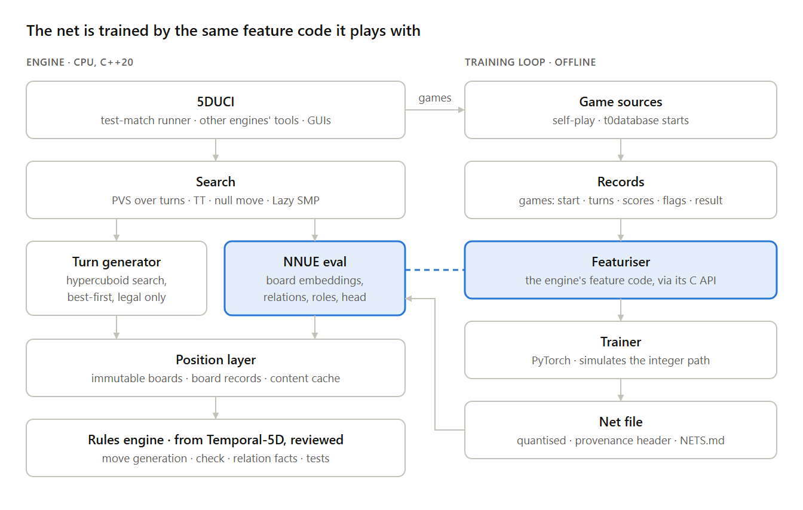
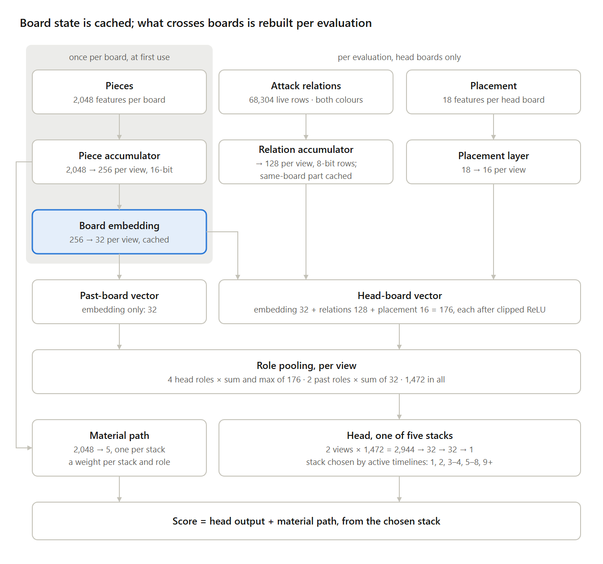
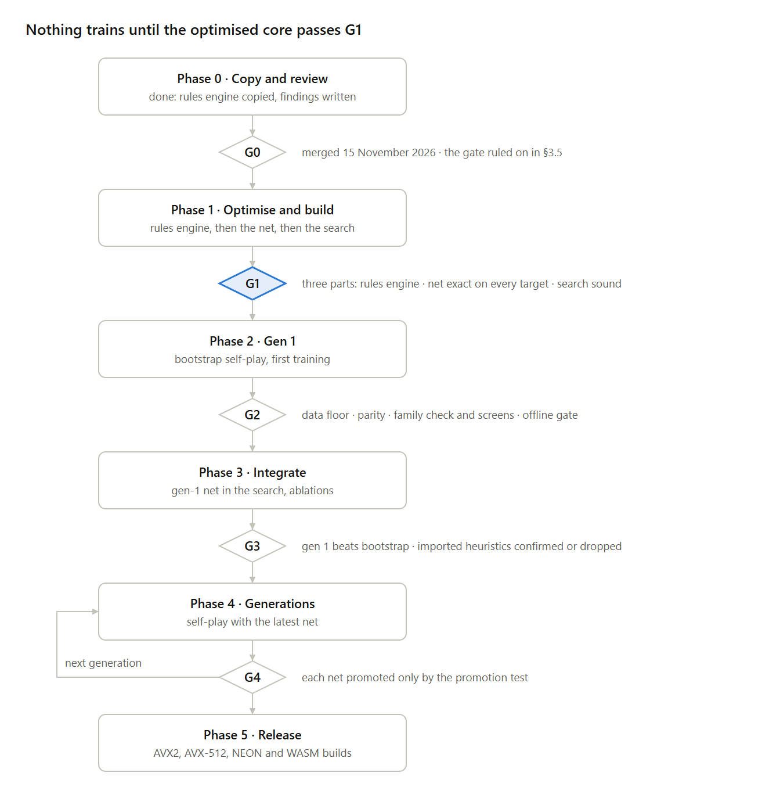

# 5D NNUE engine — design spec

1 November 2026 · Fergus

## 0. Status and scope

Revised 15 November 2026, after G0. Phase 0 is done: the rules engine is copied at Temporal-5D `c8a9c49`, builds with three toolchains on two platforms and passes the 344 of its default tests that can build (`docs/gates/G0.md`). Phase 1, optimise and build, is next. The rulings on G0 and the evidence for every decision this revision changed are in `docs/gates/G0-rulings.md`. Every bracketed ID has a row in the [decision register](DECISIONS.md).

**What it is.** A new engine for 5D Chess With Multiverse Time Travel: alpha-beta search over whole turns, evaluated by an NNUE that reads the boards themselves. CPU only, C++20, its own repo [NS1].

**What it isn't.**

- Not part of Temporal-5D, and not a second Temporal-5D engine.
- Not a Kairos fork or add-on, and not an HCE/NNUE combination: no hand-crafted eval as an input, overlay, blend or fallback [NF1].
- Not trained on any other engine's evaluations [P6, NF5].

**Relation to other projects.** Completely separate: nothing in the engine's build or in the running engine depends on either [NS2, NF10]. Test-time oracles are not such a dependency (§3.5).

- **Temporal-5D.** Its rules engine is copied in, because that code would be identical in an NNUE engine. Before changing anything, the coder reviewed it for NNUE-specific optimisations (§3) [NS3].
- **Kairos.** Ideas and test results only, no code [NS4, NF12]. Its newest eval is a board-level NNUE blended with its hand-crafted eval, so its test-match record (§13.2) is the best outside evidence available for this design.

**Goals.**

1. Play useful 5D chess within weeks, without waiting months for GPU training.
2. Run well on CPU-only machines and weak GPUs, and later in the browser.
3. Train on a desktop CPU; a GPU only speeds it up [NL4].

**Gen-1 variants** [NS5], by the names the engine resolves: "Standard", "Standard - Turn Zero", "Standard - Defended Pawn" and "Standard - Half Reflected". They share one ruleset, one board size (8×8) and six piece kinds, and differ only in their set-up. Turn Zero is the one played competitively: it is the protocol's `startpos` and every t0database game. The rulebook's confidence is high for the first two and medium for the others; Defended Pawn's set-up rests on one image and no oracle record covers it.

The engine is called Fractal; its repo is github.com/Silicon-Spider/Fractal.

## 1. Engine at a glance

*engine and training loop · only the rules engine comes from Temporal-5D*

- **Position:** a persistent multiverse of immutable boards. Each board's net state (its piece accumulator, a 32-wide embedding and the sum of its same-board relations) is computed once, the first time an evaluation needs it, and cached [NB1, NN1, NN2, NN10].
- **Turns:** the turn generator yields legal turns best first, in the order the search's own scores give them, so the search never checks a move's legality itself [NT2, NF13].
- **Search:** PVS over whole turns, with mandatory boards only below the root. The net scores positions from the cached board state plus the relations that leave each board and placement, which are rebuilt at each evaluation [NA1, NT6, NN3–NN6].
- **Training loop:** self-play games feed a PyTorch trainer that reads features through the engine's own code, so training and play see identical inputs [ND2, NL1].
- **One evaluator throughout:** before any training, a hand-set bootstrap net in the same format plays gen 1 [P4, NN8].

## 2. Principles

All eight are committed.

- **P1 Facts, not opinions.** Inputs are what's on the boards and what the rules say: pieces, attacks and placement. Nothing is hand-weighted. Unweighted rule-fact counts are facts too, but only the fallback arm NX2 may use them.
- **P2 Rules live in the rules engine.** The search and the net ask it; neither re-derives a rule [NF6].
- **P3 Immutability.** A published board never changes, so its accumulator, embedding and same-board relations are computed at most once per thread while cached, and shared by every position that contains it. Relations that leave a board depend on other boards.
- **P4 One evaluator.** The net is the only eval. Before training, a hand-set bootstrap net in the same file format stands in; it plays gen 1 and then retires [NN8, NF1, NF2].
- **P5 Measure, don't assume.** A heuristic imported from Kairos or chess stays only if an ablation test match in this engine confirms it (§12.3). Kairos's results are priors, not results, and several of the ones this design first leaned on were not wins there (§6.4).
- **P6 Self-taught.** Nets train only on this engine's own searches and game results. Human games supply start positions and a sanity check, never labels [NF5].
- **P7 Untrained first.** The whole engine, net plumbing included, passes G1 before anything trains: with the bootstrap net for play, and with seeded test nets for every exactness and cost check, since the bootstrap net's weights are nearly all zero [NM14].
- **P8 Borrowed code proves itself.** Copied code passes its own tests unchanged before any change, and again after each one [NM1].

## 3. Rules engine

The rules engine comes from Temporal-5D because it would be the same code whether the evaluator were an NNUE or a transformer. Nothing built for the transformer or its MCTS search comes across [NS3, NF11].

### 3.1 Copied

C++20 from Temporal-5D commit `c8a9c49` (head of `main`, 8 November 2026), copied on that day [NR1]. Lines count header plus source at the pin: 49 files and 15,858 lines. `PROVENANCE.md` lists all 221 copied files with their source hashes.

| Module | Lines | What it does |
| --- | --- | --- |
| types, geometry, error | 487 | Core types, board geometry, error reporting |
| board | 261 | Immutable board: 64 square codes, bitboards per colour, per kind and for unmoved pieces, content hash, en-passant square |
| timeline, multiverse | 852 | Persistent multiverse, copy-on-write per timeline; boards older than the newest few sit in shared chunks of 16 |
| zobrist | 320 | 5D position hash |
| rules, variants, state | 1,811 | Rulesets, variants, the present and the turn state machine |
| move, movegen | 1,106 | Pseudo-legal moves by walks along compile-time direction tables. Defences, x-rays and pins come from the same pass for the colour to move on a head; any piece on any board can be asked for its moves alone |
| attacks | 689 | Incremental royal-attack maps. Nothing in Fractal calls them (§3.3 item 5) |
| check | 621 | Check status (R1) and submission legality, by a scan for royal captures |
| search, legal | 1,740 | Legal-action listing and mate detection, including the depth-first detector. legal holds the per-move legality tiers and comes only because search includes it; the engine's search never calls it [NF13] |
| hypercuboid, turngen | 2,423 | Best-first legal-turn generator (§5) |
| fen, pgn | 2,722 | 5DFEN reader and writer; 5DPGN reader and replay. There is no 5DPGN writer |
| fingerprint, certificate, md5 | 510 | Position fingerprints and checkmate certificates; md5 was written from the RFC. certificate is copied but cannot build: it needs the prover, which §3.2 leaves out |
| gate | 630 | Adapter for the differential test harness |
| capi, records | 1,462 | C API for games and states. Its expansion and label calls were removed after the copy: 444 lines, the one change before G0 |
| two internal headers | 224 | `search_internal.hpp` and `capi_internal.hpp` |

Also copied:

- all 64 test files, of which 36 build; the other 28 need modules that were not copied (§3.6);
- seven files from `engine/tools` that the tests and the gate need;
- the differential harness with its five pinned oracles: ftxi, cwmtt, Chess in 5D, the notation parser, and Kairos, which is pinned but in no tier (§3.5);
- the rulebook with rulings R1–R11 [NR4]. Register IDs inside it (H36, I11 and the like) are Temporal-5D's; where a ruling leans on a Temporal-5D convention, such as R5's turn cap, Fractal's own decision replaces it [ND13];
- data/t0database with its MIT licence.

### 3.2 Not copied

Transformer and MCTS code, and the verification layer built around Temporal-5D's search [NR2, NF11]:

- **expand, labels, views:** the transformer's input expansion, per-square labels and views.
- **mcts, mcts_evaluators, selfplay, capi_search:** the MCTS search, its self-play and its C API.
- **scanner, guard, hunt, prover, ladder, assets:** alpha-beta finds its own tactics. Guard proved useful at no board count, and Hunt's hit rate on short forced mates fell from 69% under 50 boards to 35% at 100–199.
- **Temporal-5D's documents.** Copied comments cite its engine manual, build log and register; those stay in Temporal-5D. This spec's §5.2 is the generator's contract for Fractal.

### 3.3 Review checklist

G0 reviewed the copied code against this list, one finding per item: expected gain, risk and the tests affected (`docs/gates/G0.md`). The items below are what the review left standing. Changes to copied code land one at a time, each followed by the copied test suite, the gate (§3.5) and a speed measurement [NR3, P8, NM6].

1. **Board storage.** Boards, timelines and chunk lists are reference-counted handles; one physical move on a copied position costs three heap allocations and 2T + 2t + 2c count updates (T timelines, t the touched timeline's tail, c one for a full chunk), and on MinGW each update is a locked instruction. First each search thread builds its own root, which changes no copied code. Then allocation moves to per-thread pools behind the same handle types. Non-atomic handles come last, and only if pooling leaves 3% or more of node time [NB2].
2. **Board state built lazily.** New code, outside the copied board: a per-thread record per board, built at first use from the board's lineage parent by comparing square codes (§8.2). `BoardBuilder` needs no change [NN9].
3. **Cached embedding.** The 256 → 32 embedding and the material sums are kept in the same record, so pooling reads 32 cached numbers per board [NN2, NN13].
4. **Relation facts.** A Fractal-owned source over the unchanged movegen API gives every relation of §7.3: captures from moves, defences from movegen's defence records, the other colour through passed copies. It is the reference for NM2 and NM3. A dedicated scan inside the rules engine may replace it for speed, held equal to it by test, as the check scan is held equal to the generator [NI3, P2].
5. **Attack maps: not extended.** The royal-attack maps' update rule rests on boards never changing and appearing only where there was none. The relation reading's passed copies break both, and 70% of head boards are mandatory and so replaced every turn. The maps stay as copied and unused.
6. **Turn generator.** Construction applies every non-branching candidate to a fresh copy of the position only to read which squares change. In order: change sets without allocation or publishing; per-thread pooled working memory; boards built at construction reused when a turn is realised. The search's scores are already integers (§5.3). The target is 90% fewer heap allocations per node, counted by a test [NT2].
7. **Move lists.** Buffers reserved once per thread and reused, growing when a position overflows them. One t0database position has at least 626 moves, so a fixed size cannot hold.

**Order of work:** the safety net of §3.5 and §3.6 first; then 7, 6, 1; then 2 and 3 with the net plumbing; then 4. Item 6 comes before item 1 because most of item 1's traffic comes from the copies item 6 removes.

### 3.4 Copy process

Steps 1 to 3 were Phase 0 and are done (G0).

1. Pin one Temporal-5D commit. Copy the files above into the new repo. Every copied file has a row in `PROVENANCE.md` with its source path, commit and hash, and carries a five-line provenance header unless something pins its bytes or its format has no comments (39 of the 221 files) [NR5]. CI checks every row.
2. Remove capi's expansion and label entry points and the record types only they use. Change nothing else yet.
3. Build, then run the copied tests and the gate unchanged [NM1].
4. Apply the review checklist one item at a time (§3.3).
5. Merge later Temporal-5D fixes by hand, never through a dependency [NR5, NS2]. Each merge is recorded in `PROVENANCE.md` with its source commit and new hashes, and upstream is reviewed at every gate. Upstream was 18 commits past the pin on 15 November 2026, none of them touching engine source.

Licensing: Temporal-5D is yours outright under GPL-3.0, and its md5 was written from the RFC. Two files keep other notices: t0database (MIT) and the ftxi oracle driver in the harness, part of which is adapted from ftxi under BSD 2-Clause [NE5].

### 3.5 The gate and the oracles

"The gate" is the copied differential harness. It compares the rules engine with independent implementations, position by position, and it is the only test that does [NM1, NR6].

- **Oracles are test fixtures.** The five repositories pinned in `oracles/oracles.lock.toml` are checked out as git submodules under `oracles/third_party/` and run as separate programs, in tests only. Nothing outside `oracles/` reads, includes, links or fetches anything under it, and a clone without submodules builds the engine and passes the engine's own tests. One CI job keeps proving that [NS2, NF10].
- **Kairos is pinned and never built.** The harness's copy check then compares every file in this repository against Kairos's source, which is how NF12 is policed against the one outside engine most like this one. The same check refuses Kairos's name in scripts and workflows outside `oracles/`, so the yardstick runner of NM11 lives there.
- **What runs when.** `selftest`, `verify` and `gate --tier commit` run in CI on every push. `gate --tier nightly` runs on the desktop before each change to copied code merges, and at each gate report. At the pin, Temporal-5D's own CI ran the commit tier in 12 minutes and nightly in 25.
- **The release tier is not used.** It fails on 17 findings inherited from Temporal-5D's recordings, and no budget fixes them.
- **What it covers.** Until the checkouts are in place CI compares the engine with an oracle at no position. With them, the commit tier checks about 1,000 positions against ftxi. Even nightly gates only Half Reflected among the gen-1 variants: Standard and Turn Zero are compared everywhere but stay ungated for corpus reasons, and Defended Pawn has no record. Growing the corpus from t0database is an open item.
- **The oracle driver for ftxi** carries code adapted from ftxi under its BSD 2-Clause notice. It stays, as a test-only program the engine never links [NF12].

### 3.6 Tests of copied code

- **Recovered tests.** 24 copied test sources cannot build because they include an uncopied module. Three of them test copied code: `test_search` (22 tests, among them the three that hold "never mate on a budget stop"), `test_turn_state` (3) and `test_capi_game` (12). `test_search` is recovered by trimming its one case that calls uncopied code, the trim recorded in the file's provenance line and in `PROVENANCE.md`. The copied-code cases of the other two are covered by new Fractal-owned tests, since nothing built today exercises the C API's game calls.
- **Pins added before any copied code changes:** a hash of the best-first generator's output, node counts included, on every CI target; allocation counts per generated turn; a split of generator time into construction and `next()`; a test that stops a generator mid-run.
- **New Fractal-owned tests:** relations equal an independent reading through movegen before anything relies on them; generator exhaustion equals the depth-first detector on every t0database turn start.
- **Test inventory.** CI asserts the number of tests run per suite, so a test cannot drop out silently. `main` takes changes only through pull requests with green CI: branch protection, with the CI jobs as required checks.

## 4. Position and boards

- **Board** [NB1]: Temporal-5D's immutable board (64 square codes, bitboards per colour, per kind and for unmoved pieces, content hash, en-passant square, width and height). Its net state is a per-thread record outside the board, built the first time an evaluation needs it [NN9]:
    - piece accumulator: 2 views × 256 16-bit sums, 1 KB;
    - material sums: 2 views × 5, one per output stack [NN13];
    - cached embedding: 2 views × 32;
    - same-board relation sum: 2 views × 128.
- **Storage** [NB2]: reference-counted handles today; per-thread roots and pools as §3.3 item 1 sets out. Provisional until G1 measures the gain.
- **Multiverse** [NB3]: persistent and copy-on-write per timeline. A position is a value: a child shares every board and timeline it did not touch, there is no unmake, and a generated turn already carries its child. Copying a position costs one allocation and one count update per timeline.
- **Hash** [NB4]: a board's content hash is the XOR of one key per piece and square, the piece with its unmoved flag, and one key for its en-passant square. It covers neither where the board stands nor its size. The position key is a 64-bit sum of one term per board (its content hash mixed with timeline and half-turn; a history board's en-passant key left out) and one per timeline (its position and creator), finished with the ruleset, the side to move, the even or odd start and the board size. Equal boards never cancel. The search keys on `GameState::zobrist()`, which adds the activity state under the rule options where activity depends on history.
- **Content cache** [NN10]: the per-thread store of the board records above (§8.3).

## 5. Turn generation

### 5.1 Search unit

The search unit is a complete turn [NT1]: one option on every playable board of the mover's, either a move or leaving the board unplayed. Two orders of the same moves that reach one position count once (the generator's `Successors` unit). Leaving a mandatory board is legal only in a turn that rewinds the present or reactivates a timeline behind it (rules T8 and T12). Provisional: arm NX9 tests one sub-move per ply instead.

### 5.2 Generator

Temporal-5D's hypercuboid generator, copied [NT2]. Its contract, as the search uses it (`engine/include/t5d/turngen.hpp`):

- **Space.** One axis per playable board; one value per option on that board: leave it, a move within it, one half of a jump between two playable boards, or a branching move.
- **Order.** The search gives every option one score, once, when the generator is built. A turn's score is the sum over its boards, and turns arrive in non-increasing score, ties in a fixed order. The generator has no other order, so the hint, captures and history all act through option scores (§5.3). `bound()` is an upper bound on the score of every turn not yet emitted.
- **Legality.** It yields only legal turns, each once, and each carries its successor position. The search never applies moves to find out whether they are legal [NF13].
- **End.** `exhausted()` means every legal turn has been emitted; with none emitted, it proves the mover has no legal turn. `stopped()` means the budget ended the search first, and proves nothing (§5.4).

Phase 0 measured the copied generator before any change (G0; MEASUREMENTS entries 1 and 2; one thread of a Ryzen 9 9900X). Buckets are human positions with under 50, 50–99 and 100–199 boards.

| Measurement | Result |
| --- | --- |
| Pseudo-legal movegen | 1.6 / 2.5 / 3.5 µs per position |
| First legal turn (construction plus the first `next()`), median | 16.6 / 40.0 / 73.5 µs |
| Each further turn, median | 2.8 / 4.7 / 6.9 µs |
| First legal turn on synthetic positions of 100 to 600 boards, median | 0.7 to 15.5 ms; one position took 101 ms |
| Turn starts with at least 1,000 legal turns, among those with any | 12% / 46% / 70% |
| Near mate on 5 timelines, depth-first detector (`detect_mate`) | 184 nodes in 75 µs; naive enumeration 817,875 nodes |
| The same proof by the best-first generator | 796 nodes in 464 µs |

Construction dominates: the first turn costs as much as six to eleven further ones, because the generator applies every non-branching candidate to a copy of the position to read which squares change (§3.3 item 6).

**Width is set by playable boards.** In 692 human games the mover had one mandatory board in 94% / 73% / 36% of turns, but more than one playable board in 15% / 65% / 99%, and played an optional board in only 1.2% / 2.5% / 1.1% (Temporal-5D's measurement log; the last bucket is 175 turns from 13 games). Most of a wide position's thousands of legal turns differ only in quiet moves on optional boards. An all-node therefore cannot be enumerated: what the search leaves out is decided by the option scores (§5.3) and the candidate set (§5.5).

### 5.3 Option scores and order

Scores are integers, which the generator's doubles hold and sum exactly. They sit in bands, spaced so that a turn's sum shows whether it holds a hinted sub-move, a capture, or a quiet move on an optional board [NT3]:

| Option | Score |
| --- | --- |
| A sub-move of the TT hint, when the hint could not be replayed whole (§6.1) | Hint band, above every other sum |
| A capture or promotion, on any playable board | Capture band: by the victim's ordering value, then the attacker's, lowest attacker first |
| A quiet move on a mandatory board | Quiet band: killer sub-moves first, then history |
| Leaving an optional board | Zero: above every quiet move on that board |
| A quiet move on an optional board | Optional band, below every turn that leaves the board |
| Leaving a mandatory board | No higher than that board's lowest quiet move |
| The arrival half of a jump | Zero: a jump is scored once, on the board it leaves |

- **Why leaving needs a rule.** The generator takes a score for leaving every playable board. In a 249-board, 66-playable-board Temporal-5D position where every move outscored leaving, the best-scored turns played every optional board, were illegal together, and best-first spent 2,000,000 nodes without a legal turn; the depth-first detector found one in 3,672.
- **Ordering values** [NT4]: one number per piece kind, the mean of that kind's material-path weights in the loaded net (§8). They order captures and feed the exchange test of §6.2. They are search constants, never an evaluation term, and no second hand-set table exists.
- **History** [NT4]: one table per thread, indexed by colour, piece kind, destination square and whether the move leaves its board. When a quiet turn cuts off, each of its sub-moves gains depth², and each sub-move of the quiet turns tried before it loses as much. Gravity keeps values bounded: new = old + b − old × |b| / H.
- **Killers** [NT4]: the sub-moves of the last two quiet turns that cut off at the same ply.
- All of this is provisional until its G3 ablation [P5]. §6.4 gives the outside evidence for each part.

### 5.4 Budget rule

A generator spends one budget over its life [NT5]. It is counted in generator nodes and positions held, sized at G1 from positions in Fractal's own search trees, and always larger than the position's move count, because construction alone spends about one node per candidate. The copied default ceiling of 2 GiB per generator and the wall clock are never the limit in deterministic mode [NE4].

- A generator stopped by its budget proves nothing.
- If it has yielded turns, the search uses those, and the node stores at most a lower bound (§6.3).
- If it has yielded none, the node asks the depth-first detector for one legal turn under a second budget and searches that. Only if the detector also stops does the node take its static eval, flagged as unproven.
- A generator that threw an exception is destroyed. It proves nothing and is never asked again (Temporal-5D issue 535: after an allocation failure a reused generator can report false exhaustion).
- The root always plays a legal turn: the generator's best, or the detector's witness.

### 5.5 Candidate set

[NT6]

- **At the root:** every legal turn.
- **Below the root:** only turns that leave each optional board or capture or promote on it, "mandatory boards only". The node stops pulling when `bound()` falls into the optional band. In Kairos this was the largest search gain on record, +117.3 ± 6.2 Elo; humans play an optional board in about 1–2.5% of turns.
- **Widening:** a node with no legal turn in the candidate set is not mated, and a node whose candidates are all mated may still escape. In both cases the node keeps pulling from the full set (§6.3).
- **In quiescence:** §6.2.

Provisional: G3 ablates it against the full set, and against the full set at PV nodes only.

## 6. Search

| Part | v1 choice | Status |
| --- | --- | --- |
| Driver [NA1] | Iterative deepening, aspiration windows, PVS over whole turns | Committed |
| TT [NA2] | Keyed by `GameState::zobrist()`. An entry holds score, bound, depth, static eval, a proven bit and the best turn: up to three sub-moves and a bit that says whether that is the whole turn | Provisional |
| Pruning [NA3] | Reverse futility, internal iterative reduction, late-move caps at depth 1–4, late-move reductions, board-rank pruning | Provisional |
| Null move [NA4] | The rules engine's own passed position; a mated reply marks a mate threat | Provisional |
| Quiescence [NA5] | Two turns deep: capture turns, and evasions when in check (§6.2) | Provisional, arm NX1 |
| Verdicts [NA6] | From the rules engine: an exhausted generator with no turn, then check status. No repetition rule (ruling R5) | Committed |
| Proofs [NA9] | A mate score is proven only if every legal turn was searched at each defending node on its line; a node that skipped a turn stores no upper bound | Committed |
| Time [NA7] | A soft and a hard limit per move from the clock (§11); the generator budget bounds the longest stretch between clock checks | Provisional |
| Threads [NA8] | Lazy SMP over one shared TT; each thread owns its root position, pools, caches and history | Committed |

The TT's job differs from chess. The key covers every board, history included, so two move orders almost never reach one key: in 22,761 distinct human turn starts no key has two different predecessors (Phase 0 data). The table mostly carries the best turn and bounds from one iteration to the next.

### 6.1 Node flow

At a node with remaining depth d, in order:

1. **TT probe.** A stored bound of enough depth cuts off at non-PV nodes. The stored turn is the hint.
2. **Depth 0:** quiescence (§6.2).
3. **Static eval**, from the TT entry if it has one. The evaluation's relation scan also says whether any enemy relation reaches a royal of the mover's. Only then is the rules engine asked for check status (`in_check`): under the default rules the scan covers every R1 check (§7.3).
4. **Before any generator is built,** at non-PV nodes not in check:
    - reverse futility: at low depth, an eval far enough above beta returns;
    - null move, at d ≥ 3 with eval ≥ beta and never twice in a row. The null position is the one the check test builds: every active board in the present advanced unchanged, the opponent to move. It is searched to depth d − 1 − R with R = 2 + d/4, and skipped when no active board holds two non-pawn pieces of the mover's. A mated reply sets the node's mate-threat flag: no reductions and no board-rank skips there.
5. **Hint replay.** A hint that holds its whole turn is replayed through the state machine: each sub-move is checked as pseudo-legal and applied, and the turn must pass the submission test. It is searched first, and if it cuts off, the node never builds a generator. This is turn-level legality, not the per-move tiers NF13 refuses.
6. **Internal iterative reduction:** with no hint at d ≥ 4, search one ply shallower.
7. **Build the generator** with the scores of §5.3 and pull turns best first, within the candidate set of §5.5. The replayed hint is recognised by its successor key and skipped. The first turn gets the full window; later turns get a null window and a re-search on a fail-high.
8. **Late turns.** A turn is quiet when none of its sub-moves captures or promotes.
    - Late-move caps: at d = 1 to 4 a node searches at most 20 / 32 / 44 / 56 quiet turns, four times that at PV nodes. From d = 5 nothing is capped.
    - Late-move reductions: later quiet turns are searched shallower and re-searched on a fail-high. A child that turns out to be in check is searched at full depth.
    - Board-rank pruning, at non-PV nodes after 12 turns: a quiet turn that moves on two or more boards is skipped when its ranks sum to (6 + d) × the boards it moves on, or more. A sub-move's rank is the number of options on its board that scored higher.
9. **No legal turn:** the generator is exhausted over the full set and yielded none. In check, the node is mated, at a score of minus mate plus the ply; otherwise it is stalemate, a draw.
10. **Store** the result under the rules of §6.3.

Every number in this list is a starting value, most of them Kairos's, set at G1 and tuned at G3.

### 6.2 Quiescence

[NA5]

- **Stand pat** on the static eval, unless in check.
- **No capture, no generator.** The relation scan lists the mover's captures. With none, the node returns its stand-pat score without building a generator.
- **Capture turns.** Otherwise the node builds a generator in which qualifying captures and promotions keep their band, each mandatory board's best-ordered quiet move scores zero, and every other option sits in the optional band. It pulls while the turn's sum shows a capture, at most eight turns.
- **Exchange test.** A capture qualifies when its victim's ordering value is at least its attacker's, or no enemy relation defends the victim. It stands in for SEE, which has no definition across boards.
- **In check:** no stand-pat. The node searches up to four evasions from the full candidate set; an exhausted generator with no turn is mate.
- **Depth:** two turns, then the static eval.

Kairos has no capture search to compare with. It adds a per-board capture gain to the eval at quiet leaves, which NF1 refuses here, and searches only evasions; there, two turns of evasions beat three (+7.6 ± 5.5) and four lost to three (−4.1 ± 5.8). Arm NX1 tests depth 0, 2 and 4 and the exchange test.

### 6.3 Proofs and bounds

[NA6, NA9]

- **Terminal verdicts** come from the rules engine alone: the generator's exhaustion, then `in_check`. The search never calls the unbudgeted verdict functions (`outcome`, `has_legal_action`).
- **A mate score is proven** only when every legal turn was searched at every defending node on its line. A node that skipped a turn for any reason (candidate set, late-move cap, board-rank pruning, a stopped generator) can prove a win for the mover but never a loss.
- **Mate guard.** While a node's best score is a mated score, nothing is skipped: the node widens to the full set before it returns.
- **Honest bounds.** A node that skipped a turn stores a lower bound or nothing: never an upper bound and never an exact score. Kairos's fix of this fault was worth +17.4 ± 8.2.
- **Unproven scores** (§5.4) are stored with the proven bit clear and never as mate.
- With these rules the engine never reports a mate it has not proven. Pruning alone would break that promise: with late-move caps and rank pruning, every searched turn can be mated while an unsearched one escapes.

### 6.4 What comes from Kairos

Every heuristic below is in v1 on Kairos's evidence and is re-tested by ablation at G3 [P5]. Figures are Kairos's own test matches, in Elo.

| Heuristic | Kairos's result | In v1 as |
| --- | --- | --- |
| Mandatory boards only below the root | +117.3 ± 6.2 | Candidate set [NT6] |
| Reverse futility | +32.1 ± 5.2 | [NA3] |
| Internal iterative reduction | +27.3 ± 10.0 | [NA3] |
| Killers | +20.0 ± 4.9 | [NT4] |
| Board-rank pruning | +17.9 ± 7.7 in its first, tighter form; the form used here was merged at −0.2 ± 6.5 | [NA3] |
| No upper bound stored after a skipped turn | +17.4 ± 8.2 | [NA9] |
| History with gravity and maluses | +4.8 ± 6.7, inconclusive | [NT4] |
| No late-move cap from depth 5 | +1.2 ± 5.4, inconclusive | [NA3] |
| No reductions under a mate threat | +0.2 ± 5.6, inconclusive | [NA4] |

Not taken into v1: checks first (+27.4 ± 5.6), because the generator scores options before any is known to give check (arm NX22); and the per-board capture gain at leaves (+24.4 ± 5.1), which is a hand-crafted overlay [NF1]. Kairos also tested and rejected correction history twice (−5.4 ± 6.9, −2.7 ± 6.9), futility pruning (−49.8 ± 14.0, then +0.7 ± 6.6) and a learned move-ordering net (−5.0 ± 6.3), so arms NX7, NX6 and NX8 no longer run early (§15.1).

Arms for later: singular extensions [NX18], and a proof-number mate solver on a helper thread [NX21], which Temporal-5D has already measured in 5D (§15.1).

## 7. Evaluation inputs

Every input is provisional until G2 shows the net learns from it; the exclusions are committed. The evaluation is called at turn starts only, so every role and reading below is defined there.

**Views.** Each input is built twice, once per colour. A view names colours own and enemy, and Black's view mirrors ranks within the board's height (rank r becomes H − 1 − r); every square-derived index, zones included, is taken after the mirror. Timelines enter only as mine, theirs and unsigned distances, so nothing else needs mirroring. The head reads the side to move's view first (§8).

### 7.1 Boards

[NI1]

- **Head boards**, the latest board of each timeline, in four roles. The first that applies wins:
    - **inactive:** its timeline is inactive;
    - **mandatory:** the mover is to move on it, on an active timeline in the present;
    - **optional:** the mover is to move on it, ahead of the present;
    - **opponent:** the opponent moves next there.
- **Past boards** of active timelines: earlier boards of the same timeline, near (1–2 half-turns behind the head) and far (3–4 behind), read through their cached embeddings only. A short timeline has fewer: a new branch's past is not read from the timeline it left. In Kairos this window won 9.7 ± 7.0 Elo, and a wider one (3–8 behind) lost 85.9 ± 13.3.
- Older boards enter only as victims of attacks, through time travel.

### 7.2 Pieces

2,048 features per board and view [NI2]:

- 12 kinds × 2 colours × 64 squares = 1,536. The kinds: pawn, knight, bishop, rook, queen, king, unicorn, dragon, princess, brawn, common king and royal queen.
- Unmoved flags for the four kinds whose moves depend on them (king, rook, pawn and brawn) × 2 colours × 64 squares = 512.
- The square index is rank × 8 + file, anchored at a1 on every board size.
- **Gen 1 uses six kinds.** The four gen-1 variants hold only pawn, knight, bishop, rook, queen and king, and promote only to queens, so a gen-1 net has 1,152 live piece rows and the rest stay empty. The net header lists the live rows [NL5].

### 7.3 Attack relations

A relation is one capture geometry of a piece on a head board, as the rules engine's movegen produces it [NI3]: an **attack** when the piece it reaches is an enemy (a pseudo-legal capture), a **defence** when it is the attacker's own (the capture it would be, were that piece an enemy). Pins and the mover's own royal safety are ignored, x-rays are not relations, and a promoting capture counts once.

**Reading** (G0's "semantics B"). Both colours are read from every head board, whoever moves there next, and each relation belongs to the attacker's head:

- the mover's pieces on heads where the mover is to move are read on the real multiverse: these are its captures this turn;
- every other colour and head is read on that colour's passed multiverse: the real one, plus an unchanged copy, without its en-passant square, appended to every head on which that colour is not to move. This is ruling R1's check construction applied to every such head, and it shows what that colour could capture if the other side passed;
- a victim on a passed copy counts as on that timeline's head.

The reading is wider than check. Under the default rules it covers every R1 check, because a passed copy only ever stands where there was no board. It also finds royal captures that R1 does not count: in 642 of 15,387 start-game positions (G0). Royals therefore stay as victims. Stockfish dropped king victims from its threat inputs in February 2026 because it never evaluates a position in check; in 5D an attacked royal need not be check.

**Which relations** [NI3]:

- **Attacks:** all of them, wherever the victim stands, history boards included.
- **Defences:** only onto head boards and their passed copies, the boards where a capture can be answered. A piece can land only on a board where its own colour is to move. A defended piece on a history board stands on such a board, where no enemy can ever land, so the defence protects nothing. Such defences were 49.7% of all relations in the start games, and they include every case of a piece defending its own earlier self.

In the start games that leaves 81.5 relations per position of the 162.2 recorded: 15.9 attacks and 65.6 defences. 60.0 of them stay on the attacker's own board (MEASUREMENTS entry 2).

**Index** [NI4]: attacker kind × attacker colour × victim kind × victim colour × victim location × displacement class. Colours are own and enemy by view. A feature's value is the number of relations with that index.

- **Victim location:** all 64 squares on the attacker's own board; 16 zones of 2×2 squares on any other. Arm NX12 tests full squares across boards, and NX13 adds the attacker's square.
- **Displacement class** [NI5], from the board the attacker is read on to the victim's, nine in all: same board; timeline only, |ΔL| = 1, 2, 3+; time only, |ΔT| = 1, 2, 3+ whole turns; both, max(|ΔL|, |ΔT|) = 1, 2+. G0 cut these edges from the start games; the unit is whole turns because pieces move in whole turns. Time-only relations always point back in time. Unsigned; arm NX17 tests signed ΔL.
- **Size:** the full index is 12 × 2 × 12 × 2 × (64 + 16 × 8) = 110,592 rows. 68,304 are live: 32,832 can never fire (the rules engine's own probe of what each kind reaches, and pawns on their promotion rank); 8,832 are time-only defences, which always land on history; and 624 are the second half of a same-board enemy pair of one kind, which each view records once, as own attacks enemy. The six gen-1 kinds use 18,072 of the live rows, 8,472 of them on the attacker's own board.
- The live-row map is part of the feature set, and the net header's feature-set hash covers it [NL5].

**What each part depends on.** A head's same-board relations depend only on that board, so they are summed once and cached with it [P3, NN10]. Relations that leave the board depend on other boards and, through the reading above, on who is to move, so they are scanned at each evaluation: 21.5 per position in the start games.

**Why relations.** They are what links boards; §7.6 gives the outside evidence. A linear kernel over L/T offsets would update incrementally but can't tell whether a slider's path across boards is clear [NF3], and raw offsets are unbounded [NF4]. Reach, moves onto empty squares, is arm NX3. Attacks on the empty squares beside a royal, the part of reach that Kairos's best counts covered, are screened first (NX23). Per-square attacker counts, from dlshogi's inputs, are arm NX20.

### 7.4 Placement

Eighteen features per head board, recomputed at each evaluation because the present moves [NI6]:

| Feature | Values |
| --- | --- |
| Playable for the side to move | no, mandatory, optional (3) |
| Timeline owner | initial, mine, theirs (3) |
| Distance from the centre | 0, 1, 2, 3+ timelines (4) |
| Timeline state | active, inactive (2) |
| Δt to the present | behind it; 0; 1; 2; 3–4; 5+ whole turns (6) |

- **Playable** also says who moves there next: "no" means the opponent.
- **Owner:** initial timelines were created by neither player.
- **Distance** is |L| where the game starts on one timeline. Where it starts on two (−0 and +0), both count as 0 and the rest count outward.
- **Δt** is the head's half-turn minus the present's, in whole turns, rounded up. G0's histogram of 25,202 head boards puts 611 / 17,611 / 1,663 / 1,375 / 1,853 / 2,089 in the six buckets. Only inactive heads fall behind the present.

No ruleset flag [NI7]: the four gen-1 variants share one ruleset, one board size and one set of piece kinds, and differ only in their set-up. A variant with another board size or ruleset needs an input for it first.

### 7.5 Excluded

Committed exclusions [NI8, P1]:

- material values or counts, mobility counts, king-safety scores, timeline-advantage and pawn-structure terms;
- the output of any hand-crafted eval;
- search-derived values such as history or correction terms;
- global counts such as active timelines per side, because summed placement already carries them. The output-stack selector (§8) is the one use of such a count, and it selects weights rather than feeding them.

The one exception is the fallback arm NX2: unweighted counts the rules engine produces, tried only if relations fail NQ2. Its list is written before G3, from the families that paid in Kairos (§7.6).

### 7.6 What Kairos's pure net shows

Kairos's pure-net test (nodense100, 24 October) lost 255.5 ± 18.2 Elo, 399 wins to 1,737 losses, against its counts-fed net at a 75% blend. The pure net put each timeline's latest board through a 128-wide accumulator and a 32-wide embedding, then summed the embeddings by role and added role counts. Nothing in it linked one board to another.

The record cannot isolate one cause, and this design does not rest on one:

- **Several things were removed at once.** Taking away the blend alone cost 30.3 ± 9.7. Of the 172 counts the pure net lost, about 20 relate pieces on different boards and about 20 describe the timeline structure; about 122 are single-board facts that the net then had to relearn through a 32-wide embedding. The pure net was a single untuned run.
- **Cross-board and royal facts did pay when added.** Kairos gained 103.9 ± 15.8 from counts of cross-board danger to royals (travel landings beside a royal and whether they are defended), 35.3 ± 10.6 from worst-board and defended-square terms, and lost 25.1 ± 9.5 when its threat terms were removed.
- **Its relation channel played once.** A net with a 64-wide relation accumulator, the counts still on and trained on all positions, lost 43.0 ± 10.9 to the hand-crafted eval. The channel was dropped the same day at 3.0 µs per eval and was never tested in isolation.
- **Capacity was not tested either.** Widening the counts-fed net to 256 did not help (−7.2 ± 6.9, −3.9 ± 7.1); no pure net wider than 128 was tried.
- **Games end in mate:** 99.65% of 1.68M Kairos test games. That shows where games are decided, not that the deciding attack crosses boards.

What this design does about it:

- relations for both colours, attacks everywhere and defences where a recapture can happen (§7.3);
- the same-board part cached with the board, so the channel costs a scan of what leaves each board, not a move generation per eval (§8.5, NM6);
- sum and max pooling (§8). Kairos's own sum-and-max test was +4.0 ± 6.7 with its counts present, two of them worst-board maxima;
- a board-only control that repeats Kairos's test in this engine [NM10], and a family-by-family check offline at G2 before any match [NM12].

The remaining risk: the net must learn aggregates such as "defended only by the king" that the counts handed Kairos ready-made. If relations close too little of the gap by G3, NX2 is next.

## 8. Network

*v1 network · cached board state, per-evaluation relations and placement, sum-and-max pooling, head plus material path*

A net for the six gen-1 piece kinds has about 3.1M parameters and a 3.4 MB file; the full twelve-kind index would have about 9.8M and 10 MB. The relation table is three quarters of the first and nine tenths of the second.

| Stage | Shape, per view | Computed |
| --- | --- | --- |
| Piece accumulator [NN1] | 2,048 → 256, 16-bit rows | Once per board, at first use |
| Material path [NN13] | 2,048 → 5, one column per output stack | Once per board, with the accumulator |
| Board embedding [NN2] | 256 → 32: clipped ReLU, dense layer, clipped ReLU | Once per board, cached with it |
| Relation accumulator [NN3] | 68,304 live rows → 128, 8-bit rows; then clipped ReLU | The same-board part once per board; the rest per evaluation, on each head board |
| Placement layer [NN4] | 18 → 16, then clipped ReLU | Per evaluation, on each head board |
| Head-board vector | 32 + 128 + 16 = 176 values, each 0 to 127 | Per evaluation |
| Role pooling [NN5] | 4 head roles × (sum, max) × 176 + 2 past roles × sum of 32 = 1,472 | Per evaluation |
| Head [NN6, NN7] | 2 views × 1,472 = 2,944 → 32 → 32 → 1, clipped ReLU between layers, one of five stacks | Per evaluation |
| Score | The head's output plus the stack's material term | Per evaluation |

- **Activation before pooling.** Every part of a head-board vector passes a clipped ReLU first, so a role's sum adds up what each board's detectors found and its max is the strongest board. Without it the summed relation part would be one bag of relations for the whole role.
- **Roles** [NN5]: mandatory, optional, opponent and inactive head boards, each pooled by sum and max; past boards near and far, by sum. The max lets one board's mating attack count in full instead of being diluted across quiet boards (§7.6). A role with no board gives zero for both. KataGo's pooling layers output a mean, a size-scaled mean and a max; its value head keeps the means. Arm NX19 tests sum alone, and mean with sum and max.
- **Material path** [NN13]: the piece table carries five more columns, one per output stack, with own pieces positive and enemy pieces negative in each view. A stack's material term is the sum over the four head roles of a role weight times half the difference between the mover's view and the other's, summed over the role's boards. Role weights are learned, one per stack and role. Material is learnable from the first batch, and the rest of the net only learns what material misses. Stockfish fed piece values to its score this way from 2021 until September 2026, when it removed the path at no measured loss on hundreds of billions of positions; Fractal keeps it because it is the bootstrap net and gen 1 is small.
- **Output stacks** [NN7]: chosen by active-timeline count: 1, 2, 3–4, 5–8, 9+. In training, the first head layer has a part shared by all stacks, folded in at export, and a stack with too few samples is served by its lower neighbour; the header records the mapping. Human play sits low on that scale: 85% of t0database's distinct turn starts have under 50 boards, where the mean is 1.4 active timelines (MEASUREMENTS entry 1). So G2 reports the positions per stack and re-cuts the edges from gen-1 data (§9).
- **Views:** each board is accumulated from both colours' views (§7), and the head reads the side to move's view first. The score is from the mover's side.
- **Score scale:** one score unit means the same from net to net: win probability is a logistic of score / K, with K = 400 fixed in the net header [NL5]. Training targets are built against that scale (§9).

### 8.1 Bootstrap net

The bootstrap net is the material path alone, in the same file format, with every other weight zero [NN8, P4]:

- **Material columns:** pawn 100, knight 400, bishop 450, rook 350, queen 1,200, king 0, the same in every stack. No agreed 5D values exist: three of the four published sets put bishop ≥ knight > rook, and the two hand-set 5D tables put a queen at 2.4 to 3 bishops. Treat every value as good to about ±40%. The six other kinds get values when a variant with them is added.
- **Role weights:** in each stack, one over its typical active-timeline count (1, 1/2, 1/3.5, 1/6.5, 1/12) for mandatory, optional and opponent boards, and a quarter of that for inactive ones. The bootstrap then scores mean material per board. A plain sum would reward a side that is ahead for branching, since a branch copies a board it is winning on.
- It is blind to everything else, timeline advantage included. It only has to make gen-1 games sensible, and it retires once gen 1 beats it [NQ1].

### 8.2 Incremental contract

[NN9]

- **Per-board record:** a board's piece accumulator, material sums, embedding and same-board relation sum live in a per-thread record outside `t5d::Board`, built the first time an evaluation needs them. The record also notes, for each colour, whether a royal is attacked on the board (§6.1). Many boards the turn generator builds are never evaluated.
- **Built from the lineage parent:** the previous board on the timeline, or for a timeline's first board the board it branched from. The two boards' 64 square codes are compared and the columns of the squares that differ come off and go on; under the default rules a played board differs from its parent on at most four squares. A board with no parent, or whose parent has no record, is built from scratch. The same-board relation sum is rescanned from the board itself.
- **Relations that leave the board** are scanned at each evaluation, for every head board, through the rules engine (§3.3 item 4).
- **Placement** is recomputed at each evaluation for head boards; it is 18 features.
- Every incremental result equals a from-scratch rebuild, checked at every node in tests with the test nets [NM2].

### 8.3 Caches

[NN10]

- **Content cache:** per thread, keyed by the board's content hash, the board size and the net; a hit is confirmed against the 64 square codes and the en-passant square. It holds the per-board record of §8.2, which is the only store of that record, and it is bounded and evicts. Hits come from lines searched again at the next depth, sibling turns that share a sub-move, passed copies, and one board reached by two move orders.
- **Successor boards:** a generated turn already carries its successor position. The boards the generator builds while it is constructed are kept and reused when a turn is realised, as part of §3.3 item 6.

### 8.4 Integer pipeline

[NN11]

- **Types.** Piece rows and both accumulators are 16-bit; relation rows are 8-bit, widened as they are added; dense weights are 8-bit; dense sums are 32-bit. Stockfish stores its threat rows in 8 bits for memory bandwidth, and Fractal's relation table is where the memory is.
- **Accumulators wrap.** Rows are added and removed with wrapping arithmetic, never saturating, so any order of adds and removes equals a from-scratch sum [NM2].
- **Bounds are proven, not hoped for.** A board holds at most 64 pieces. A board and view count at most 250 relations: beyond that the scan stops in a fixed order and counts the overflow, and G1 reports how often. The exporter proves from each layer's weight ranges and these counts that no accumulator or dense sum can leave its type, and refuses a net that could.
- **Byte products stay in range.** Every value multiplied as an unsigned byte is 0 to 127 and every 8-bit weight is −127 to 127. The AVX2, AVX-512, VNNI, NEON and WASM paths then agree by arithmetic, since the 16-bit pair sums of AVX2 cannot saturate.
- **Pooled values.** A role's sum is clipped to 8,191, which is 64 boards at full activation, and enters the first head layer as a 16-bit value; a max is 0 to 127. That layer's 32-bit sums then cannot overflow.
- **Rescales** are right shifts that round toward minus infinity, by powers of two stored in the net header [NL5]. Nothing divides.
- **No floating point** in the evaluation or in any search decision, and no signed overflow: CI builds the scalar path with the undefined-behaviour sanitiser. The WASM build uses no relaxed-SIMD instruction.
- Training simulates the rounding [NL7], and the output is bit-identical across AVX2, AVX-512, NEON, WASM and the Python reference [NM3, NM4].

### 8.5 Cost

Evaluation takes at most half of search time [NN12, NQ4]. It is measured at G1c with a test net (§12.1), in a fixed-depth, one-thread search over Phase 0's human-position buckets, after §3.3 item 6 has cut the generator's cost. G1b first records microseconds per evaluation by bucket. Per evaluation the work is: a few column updates and one board's relation scan per new board, the relations that leave each head board, 176 or 32 numbers pooled per board, and a 2,944 × 32 head.

The attack channel is the risk. Kairos dropped its own at about 3 µs per eval, mostly move generation, and Stockfish's first threat-input port lost 90 Elo before it updated incrementally. Defences double the table's rows and were nine tenths of the relations Phase 0 recorded, which is why v1 keeps only those that can matter (§7.3) and caches the same-board part. G1 measures the channel first, with attacks alone and with defences [NM6, NX4].

## 9. Training data

| Decision | Choice | Status |
| --- | --- | --- |
| Records [ND1] | Games, never features: a game's start and its turns, with one annotation per searched position (§9.1) | Committed |
| Gen 1 [ND2] | Self-play with the bootstrap net: at least 10M positions that pass the quiet filter, from at least 250,000 games; more if G2's learning curve is still falling | Provisional, G2 |
| Gen 2 on [ND3] | Self-play with the latest promoted net. Training uses every generation so far until a size budget binds, then drops the oldest | Provisional, G4 |
| Starts [ND4] | The engine's own opening generator for every variant, plus positions from t0database's start games, which are all Turn Zero (§9.2) | Provisional, G2 |
| Labels [ND5] | λ × P(score) + (1 − λ) × result, in win-probability space (§9.3). λ is the weight on the score: 0.2 in gen 1; later generations choose among 0.3, 0.5 and 0.7 by test | Provisional, G2 |
| Filter [ND6] | Quiet positions only, applied when data is loaded, not when it is recorded | Provisional, arm NX5 |
| Provenance [ND7] | Engine commit, net hash, variant, start source, search settings, the machine or runner and its CPU model on every game | Committed |
| Validation [ND8] | Split by game. A twentieth of each generation's games is held out for the offline gate; a held-out third of t0database is a sanity check (§9.4) | Committed |
| Rescoring [ND9] | Stored positions re-searched with each newly promoted net, refreshing the window's scores | Provisional, G4 |
| Depth caps [ND10] | Every turn's position is recorded. A quarter of turns, picked before the search, get the full node budget; the rest get a sixth of it | Provisional, G2 |
| Sample weights [ND11] | Uniform. Weighting by search surprise is screened offline first (NX27) | Provisional, G2 |
| Actions shards [ND12] | Self-play stays on the desktop unless the measured rate needs more; overflow shards then follow §11 | Provisional, G2 |
| Game end [ND13] | The rules engine's verdict, or a cap of 200 turns or 400 boards. A cap is not a verdict | Provisional, G2 |
| Mixing [ND14] | The whole window is shuffled across games each epoch; of duplicate positions the newest label is kept | Committed |

### 9.1 Records

A record is a game: its variant or initial boards, then its turns in the protocol's move form (§11). This is the only lossless form. 5DFEN board strings cannot carry the side to move, an en-passant square or who created a timeline, and a position rebuilt from them can differ in legal moves and in its key.

Each position the engine searched carries: the score from the mover's side, depth and nodes, the best turn, the static eval, and flags: in check, best turn captures or promotes, the node budget class, and whether the score is proven, unproven or a mate. The game carries its result, how it ended (mate, stalemate or which cap) and its provenance [ND7].

Positions are stored, never features, because features change with the net and positions don't [NF7]. Filters read the flags at load time, so one data set serves every filter and every input arm.

### 9.2 Self-play

- **How a game ends** [ND13]. The only draw in the rules is stalemate, there is no repetition rule (R5), and every move adds a board, so a game need not end. Self-play and match games stop on the rules engine's verdict or at the cap, which is twice the longest human game on record (99 turns, 186 boards). In a match a capped game is a draw. In training it has no result: its positions train on their scores alone. G2 reports the cap rate, and above one game in five the bootstrap settings are revisited before anything trains.
- **Clock.** Self-play runs on the node clock (§11), so a game depends only on its seed and settings [ND7].
- **Opening generator** [ND4]. From the variant's set-up, 4 to 12 turns drawn at random from the candidate set of §5.5, each with a one-in-five chance of preferring a branching turn when one exists. A start is kept if it is not terminal and a shallow search scores it within a balance margin. Node budgets carry a jitter of ±15% so equal starts do not replay equal games.
- **t0database starts.** A random turn start from the start games: 465 usable games, 15,387 distinct positions, all Turn Zero. Standard, Defended Pawn and Half Reflected starts come from the generator alone.
- **Timeline mix.** Random openings rarely branch, and human games sit low too: of the 692 usable games 31% end on one timeline and 1% reach nine, while the head has a stack for nine and up. Starts are drawn to feed every stack: deep positions from multi-timeline human games, and the generator's branch preference. G2 reports the share of positions per stack; a stack under 2% is merged with its neighbour for that generation (§8).
- **What must be reported with every generation:** results, game lengths, the mate, stalemate and cap shares, positions per stack and per variant, and the share of distinct positions.

### 9.3 Labels and loss

[ND5]

- **Target.** p = λ × sigmoid(s / K_g) + (1 − λ) × r. s is the recorded search score from the mover's side, with mate scores clamped; r is 1, ½ or 0 for the mover. K_g is fitted to the generating net's own games, so that sigmoid(s / K_g) predicts their results, and is recorded with the data set.
- **Loss.** The mean of (sigmoid(out / K) − p)², where out is the net's output and K the fixed scale in the net header (§8). Every later net is therefore calibrated to the same scale.
- **λ is the weight on the score.** The bootstrap net knows only material, so gen 1's scores are weak and results carry most of the label. Later values are chosen by test; mature self-taught chess engines settle near 0.6 to 0.7, and Kairos's 70/30 beat its 90/10 by 27.0 ± 16.9. (The bullet trainer's `wdl` parameter is 1 − λ.)
- **Not trained on:** positions whose score is unproven (§5.4), and the result term of capped games.

### 9.4 Filter and validation

- **Quiet** [ND6] means: not in check (R1's check status), no sub-move of the best turn captures or promotes, and the search score within K/8 of the static eval. All three are read from the record's flags and numbers, which were fixed when the position was searched, so the filter does not depend on the net being trained.
- **Why quiet only.** Stockfish and the bullet trainer both skip positions in check or with a capture as the best move. Kairos's one test is confounded: its all-positions net also carried the relation channel when it lost 43.0 ± 10.9 to the hand-crafted eval. Arm NX5 is the real test, and it needs no new data.
- **The offline gate's set** is a twentieth of each generation's games, split by game, sampled uniformly and never weighted, so losses are comparable between nets trained on the same labels.
- **t0database's held-out third** [ND8]: 254 of 761 games by cluster of duplicate rows, 227 usable, never supplying a start for self-play or for a match. Each net is scored on it against the human results as a sanity check: it can catch a broken net, not rank two good ones. Rows whose recorded winner contradicts the rules engine's verdict on the final position are left out (ftxi's audit of the same file found 22), as are clusters whose rows disagree.

### 9.5 Why these choices

- **Why t0database starts.** They reach positions random openings do not. t0database holds 761 human games, 93% of them from 2021–2022, all recorded as Turn Zero; 692 replay to the end (691 under the check ruling), with 27,097 turns. That is enough for starts and a sanity check, and too small for labels [P6].
- **Why record every position.** A 5D game has few positions per result, about 39 turns in a human game, and in gen 1 the result is four fifths of the label. KataGo records only its full searches, but its reason is the pull between policy and value targets, which Fractal does not have.
- **Why a growing window.** In Viridithas's record, nets trained on new data alone lost 60 to 107 Elo to nets that kept the old data; KataGo's window grows from 250,000 samples to 22 million. Unshuffled data alone has ruined nets there.
- **Why rescoring is only provisional.** Records hold games, so a new net's search can relabel the window. Kairos's deep relabelling of hard positions fitted results better, yet none of the three nets trained on it gained (−4.3 ± 7.0, −3.5 ± 7.0, −9.7 ± 7.4). Stockfish 19's relabel was a single pass with a much stronger outside net, which is refused here [NF5]. G4 measures whether a re-search with Fractal's own net pays.
- **Why uniform weights.** KataGo's surprise weighting is for its policy target; it calls the value form experimental. Kairos's heavier weighting of hard positions did not gain either (the −9.7 above).
- **Gen-1 node budgets** are set once the datagen rate is measured (open items).

## 10. Training pipeline

- **Featuriser** [NL1]: the engine's own feature code, exported through its C API. One call replays stored games in worker threads and fills a whole batch: index arrays, the map from each board to its position and role, and targets. Training therefore reads exactly the indices the engine computes [NM3]. Calling once per position from Python is far too slow.
- **Trainer** [NL2]: PyTorch, with sparse embedding bags for piece and relation features and a sum and max per role per position. AdamW, a learning rate of 1e-3 with a short warm-up and a decay, batches of 16,384, weights clamped to their integer ranges after every step, and a run length set in samples and stopped on the held-out loss. An integer reference in Python reproduces the engine's quantised output exactly [NM3]. These are starting values, settled at G2.
- **Factorised features** [NL3]: during training, shared virtual features (piece kind and colour across squares; attacker and victim kind across locations and classes) help the sparse relation table learn from limited data. Real relation rows start at zero, so a row never seen in training equals its factors at export. The integer clamp applies to the folded sum. Provisional, G2.
- **Quantisation-aware training** [NL7]: float for the first steps, then activations floored and weights rounded with straight-through gradients, with power-of-two scales, as Stockfish 19 trains. Provisional, G2.
- **Auxiliary targets** [NL8]: training-only heads predict facts from the game's future: which side is mated and the timelines where a royal falls, material per board a few turns on, and the score at greater search depths. They are dropped at export. KataGo's ownership and score targets sped its learning 1.65× in ablation. Their gradients are held to 10–40% of the main loss, and they are kept only if they lower held-out loss on the main target. Provisional, G2.
- **Symmetry** [NL9]: the file mirror is an exact symmetry of the rules (§12.1 tests it), so the loader also yields each position's mirror with the same label. Provisional, G2.
- **CPU first** [NL4]: training runs on a desktop CPU, never on GitHub Actions; a GPU only speeds it up. G2 records the trainer's positions per second and sets run lengths from it.
- **Net file** [NL5]: a header with magic, format version, architecture and feature-set hashes, quantisation scales, the score scale K, the stack map, data provenance and a checksum. The feature-set hash covers the piece kinds, the live-row map, the displacement and Δt edges and the relation reading.
- **Net log** [NL6]: NETS.md records each net's data, training settings, offline-gate result and test-match result. A net is promoted only by the promotion test of §12.3, and the last good net stays the default.

## 11. Protocol and platforms

- **Protocol** [NE1]: 5DUCI as it already exists, ftxi's draft 0.3.3 (`docs/5duci.md` in ftxi/5dchess_engine), which Kairos and Kata5DChess also speak. Fractal therefore plays other engines, and runs under their match tools, with no adapter.
    - Handshake `5duci` / `5duciok`, then `isready`, `5ducinewgame`, `setoption`, `position`, `go`, `stop`, `quit`.
    - A move is long algebraic with its boards: `(0T1)e2e3` on one board, `(0T1)e2(1T0)e2` for a jump, an optional promotion letter. The word `submit` ends a turn.
    - `position` gives the initial boards, or `startpos` for Standard - Turn Zero, and then the whole game as moves. That start-plus-moves form is the only lossless way to send a position (§9.1), so 5DFEN is used for initial boards only. The other gen-1 set-ups arrive as their initial boards.
    - `go` takes `movetime`, `depth`, `nodes`, the clocks `wtime` / `btime` with `winc` / `binc`, and the two delays Kairos added, per turn and per active timeline, since the game's own clock is main time plus a delay for each active timeline.
    - `bestmove` returns every move of the turn in a playable order, without `submit`; `nobestmove` says the mover has no legal turn. `info` lines carry depth, score (`cp` or `mate`), nodes, nps, time and the principal variation, with `submit` closing each turn. Depth and mate distance count turns.
    - Fractal's own additions are commands other engines ignore: `bench`, a fixed search set with a node-count signature, and `eval`, which prints the evaluation's parts for the current position.
    - The reader and writer of these moves, and the mapping of timeline labels in even-start games, are new Fractal code. No copied file changes: the copied move writer produces another dialect, and there is no 5DPGN writer.
- **Options** [NE2]: `Threads`, `Hash`, `EvalFile`, `MoveOverhead`, and `Nodestime`, which counts the clock in nodes instead of milliseconds. Option names are single words, as the draft requires.
- **Targets** [NE3]: x86-64 with AVX2 and AVX-512, ARM with NEON, and WASM SIMD through Emscripten in Phase 5, without relaxed SIMD. Binaries that run on machines other than the one that built them are built for the x86-64-v3 baseline. Threads in the browser need cross-origin isolation, so the browser build may be single-threaded; its net budget is an open item.
- **Determinism** [NE4]: a single-thread search limited by nodes, or run with `Nodestime`, gives the same result on every run, compiler and SIMD target. That holds because option scores are integers, generator budgets count nodes and positions held (§5.4), every ordering has an explicit tie-break, and no search decision uses floating point: reduction tables are integer tables in the source.
- **Licence** [NE5]: GPL-3.0, copyright yours, except two notices kept with their files: data/t0database (MIT), and the part of the ftxi oracle driver adapted from ftxi (BSD 2-Clause), which is test-only.
- **Toolchain** [NE6]: C++20; g++ 13 or later, or clang; CMake and Ninja; on Windows, MSYS2 ucrt64, where g++ 16.2 is set up. Tests also need Python 3.12 or later and git, on Windows the native builds rather than MSYS2's. CI builds with g++ 13.3, clang 18.1 and MSYS2's g++ 16.2.
- **Compute** [NE7]: the desktop by default, and always for training [NL4]. GitHub Actions runs CI and the gate's commit tier on every push, and adds spare capacity for test matches from Phase 3 [NM13] and, only if the measured rate needs it, self-play shards from Phase 2 [ND12]. Every Actions job also runs locally with the same command, and nothing depends on Actions being available.
    - **Facts** (GitHub's documentation, read 15 November 2026): standard runners are free for public repositories; a Linux runner has 4 CPUs, 16 GB of RAM and 14 GB of disk; a job is capped at 6 hours; the Free plan runs up to 20 jobs at once. A free arm64 runner exists, which is where NEON is checked; AVX-512 is checked on the desktop.
    - **Runners differ.** They come from a mixed pool with no CPU model promised. Shards therefore run the baseline build on the node clock, both engines of a match on the same runner, and record the runner's CPU model [ND7].
    - **A written budget.** GitHub's terms allow Actions for developing and testing the software in the repo and forbid a burden out of proportion to that, without giving a number. A match is at most 20 jobs of at most one hour; one match or datagen run at a time, queued rather than cancelled; never on a schedule; artefacts kept a week; status calls kept under the token's 1,000 requests an hour. Test matches are plainly testing. Self-play is less plainly so, which is one reason it stays on the desktop by default. If GitHub restricts the repo, the work moves back to the desktop.
    - Kairos runs a match this way as 39 jobs of about 15 minutes, about 7,800 games.

## 12. Testing and predictions

### 12.1 Measurements

| ID | Check | Gate |
| --- | --- | --- |
| NM1 | The copied tests pass, and the gate's commit tier passes, after every change; the nightly tier passes before a change to copied code merges (§3.5) | G1 |
| NM2 | Incremental board records and relation sums equal a from-scratch rebuild at every node, with the test nets | G1 |
| NM3 | Featuriser and integer reference match the engine exactly, on trained nets and on the test nets | G2 |
| NM4 | One eval checksum on every SIMD target, over a fixed position set covering every variant, stack and role, with the bootstrap net, the current net and the test nets. A position and its colour swap give the same eval | G1 |
| NM5 | Own tactics and mate sets from t0database and self-play, every mate proven by a terminated run of the depth-first detector, never a budget stop | G3 |
| NM6 | Search time split by stage (movegen, turn generation, relation scan, board records, pooling, head). The attack channel's cost comes first, with attacks alone and with defences | G1 |
| NM7 | Own test-match runner: paired openings, pentanomial GSPRT in normalised Elo (§12.3). Its LLR is checked against published fishtest results | G3 |
| NM8 | Results bucketed by the opening's active-timeline count, with many-timeline openings reported apart | G3 |
| NM9 | Offline gate, a filter and not a verdict: against the current net on the same labels, held-out loss within a tolerance, exact parity [NM3] and no fewer mates solved in the mate set. The match decides | G2 |
| NM10 | Board-only control: the same net without relation inputs, trained on the same data | G3 |
| NM11 | Kairos at commit `194e426` as an outside yardstick, run as a separate program over 5DUCI from the harness's directory (§3.5) | — |
| NM12 | Family check, offline on the same data: board-only; plus attacks; plus defences onto heads (v1); plus defences onto history boards. Compared on held-out loss and eval cost before any match | G2 |
| NM13 | Test matches on GitHub Actions: shards on disjoint openings, both engines on the same runner, pair counts summed by the runner and each shard checked against the pool (§12.3) | G3 |
| NM14 | Test nets: seeded random nets of the full v1 shape with every weight non-zero, built to reach every clipping bound. The bootstrap net has only material weights, so without them NM2, NM4 and NM6 would pass on wrong features | G1 |
| NM15 | Search soundness on tiny multiverses: with pruning, reductions, the null move and the candidate limit off, the search's value equals plain minimax over the generator's turns; with them on, it never reports a proven mate that the plain search refutes | G1 |
| NM16 | Search function: every mate in one in the start games is found at depth one; 1,000 self-play games end in a verdict or the cap with no illegal turn; the `bench` node count is equal on every CI target; a Lazy SMP run returns a legal turn | G1 |
| NM17 | Sanitiser builds in CI: address and undefined-behaviour on every push, thread on the Lazy SMP tests | G1 |
| NM18 | Rules symmetries: a position's colour swap and its file mirror give the same move counts, check status and legal-turn counts in the rules engine | G1 |

**The colour swap** swaps the colours, mirrors ranks within the board's height, negates timeline positions (in an even-start game L becomes −1 − L), swaps who created each timeline and shifts every half-turn by one. Under the default rules it is an exact symmetry. The eval is from the mover's side, so a position and its swap score the same, not opposite. The file mirror is a second exact symmetry; the net is not built to respect it, so it is used for training data [NL9] and not as an eval test.

### 12.2 Predictions

Each is written down before its test runs. Those stated in Elo are measured by a fixed-length match and pass when the lower end of the 95% interval clears the figure (§12.3).

- **NQ1:** gen 1 beats the bootstrap net by more than 100 Elo.
- **NQ2:** the full net beats the board-only control by more than 100 Elo. If it doesn't, arm NX2 is next.
- **NQ3:** that margin grows with active timelines.
- **NQ4:** eval takes under 50% of search time, measured as §8.5 says.
- **NQ5:** quiescence at two turns beats zero and four.
- **NQ6:** by gen 8 the engine beats Kairos at commit `194e426`, at 10+0.1 with one thread each on the desktop.
- **NQ7:** at G2, adding defences onto history boards does not lower held-out loss (NM12's fourth net).
- **NQ8:** at G3, the mandatory-boards candidate set beats the full set by more than 50 Elo.
- **NQ9:** fewer than one bootstrap self-play game in five ends on the cap.

### 12.3 Test matches

**Statistics** [NM7]. Each opening is played twice with colours reversed, and the pair is the unit: five outcomes, a generalised SPRT in normalised Elo, error rates of 5% each way.

| Class | Used for | Rule |
| --- | --- | --- |
| Gainer | An arm, a new heuristic, or an imported one earning its place [P5] | SPRT on [0, 10]; on [0, 5] once measured gains fall under about 10 |
| Non-regression | A simplification, a removal, a refactor | SPRT on [−10, 0] |
| Promotion | A new net [NL6] | SPRT on [−5, +5] |
| Measurement | Predictions, anchor ratings, the outside yardstick | A number of pairs fixed in advance (1,000 unless stated), reported with a 95% interval |

- **Inconclusive results.** A test that has not decided after 12,000 games on a width of 10, or 42,000 on a width of 5, is stopped as inconclusive, and the simpler engine is kept. Kairos's record shows why a rule is needed: 77% of its standard tests ended inconclusive at about 7,500 games, and 37 of those changes were merged anyway.
- **An SPRT decides; it does not measure.** Its Elo estimate is biased upward for the winner, so strength figures come only from the measurement class.
- **G3's ablations** test each imported heuristic as a gainer, v1 against v1 without it. Confirmed means the test accepts the gain; anything else is dropped.

**Clock.** The node clock (`Nodestime`, §11) is the default: for net-against-net tests, every Actions shard and self-play. It is deterministic and immune to runner speed, and time management still runs. A change that alters speed (an input family, a width, a checklist item, quiescence depth) must also pass on the wall clock, 10+0.1 with one thread on the desktop; a net that gained 23.8 ± 7.2 at fixed nodes in Viridithas's record lost 21.5 ± 6.7 at a long time control.

**Openings.** Generated by §9.2's generator on its own seed stream, plus a tenth of t0database's start games set aside for matches by game cluster: balanced by a shallow search, each used for one pair, never repeated within a test, and never from held-out games. A book holds at least 25,000 openings.

**Endings.** The rules engine's verdict, or the cap of ND13 as a draw. No adjudication by score: mating technique is part of what is tested. Crashes, illegal turns and time losses are losses, counted apart, and any of them flags the test. The runner replays every turn through Fractal's rules engine, whichever engines are playing.

**Before any long test,** a smoke match of 100 games: a plumbing fault shows as hundreds of Elo within that many games.

**Promotion** [NL6]. One candidate per generation, chosen before its match by the offline gate [NM9]. The promotion test passes an equal net half the time, a net 5 Elo better 95% of the time and a net 10 Elo worse 0.3% of the time, so the loop neither stalls on small gains nor drifts downward. Progress is measured separately: each promoted net plays fixed-length matches against fixed anchors (the bootstrap net, gen 1, the last promoted net, and Kairos when NM11 is set up). Per-generation gains are never added up.

**Shards** [NM13]. Each draws its own slice of the book; the five pair counts are summed; each shard's counts are tested against the pooled distribution, and an outlier is rerun.

**Tuning.** After G3's ablations the constants of the heuristics that survive are tuned by SPSA, and the tuned set is then tested as a gainer.

## 13. Sources

### 13.1 Temporal-5D

The code copied under §3, at commit `c8a9c49`. Designs and measurements cited from its engine manual, build log and measurement log, read from a clone at the pin: turn width and how often optional boards are played, the best-first generator's failure on a wide position, the legality worst cases, and its proof-number mate solver's results in 5D.

### 13.2 Kairos's test record

Kairos's shipped evaluation is a board-level NNUE used at 75%, blended with its tuned hand-crafted eval and a small residual net. The NNUE has 128-wide per-board accumulators, 32-wide board summaries, six board roles and 172 hand-crafted counts as inputs, with its relation channel off. Read on 15 November 2026, with main at `194e426` and results from its test-match branch: 497 test summaries over 4.13M games. Figures are Elo with their error bars; its search results are in §6.4.

| Test | Elo | Used here |
| --- | --- | --- |
| First NNUE, 50% blend, against its hand-crafted eval | +89.0 ± 22.6 | NNUE with alpha-beta pays in 5D |
| A quiet-trained net that reads the 172 counts, unblended, against the hand-crafted eval | +32.5 ± 25.7 over 600 games | A net fed the counts can replace the hand-crafted eval; it says nothing of a net without them |
| Pure net (no counts, no relations, no blend) against its counts-fed net at a 75% blend | −255.5 ± 18.2, 399 wins to 1,737 losses | §7.6; board-only control [NM10], family check [NM12], fallback NX2 |
| Counts-fed net at 100% instead of a 75% blend | −30.3 ± 9.7 | Part of the pure net's loss; no blending here [NF1] |
| Counts of cross-board danger to royals, added | +103.9 ± 15.8 | The best evidence that linking boards pays (§7.6); screen NX23 |
| Worst-board and defended-square terms, added | +35.3 ± 10.6 | Max pooling [NN5]; defences [NI3] |
| Threat terms, removed | −25.1 ± 9.5 | Attack relations [NI3] |
| 256-wide board accumulators instead of 128, counts on | −3.9 ± 7.1 and −7.2 ± 6.9 | Widening the counts-fed net did not pay; a pure net's capacity was never tested |
| Relation channel, 64 wide, inside a counts-fed net trained on all positions | −43.0 ± 10.9 against the hand-crafted eval; dropped the same day at 3.0 µs per eval | Never tested in isolation. Cost measured first here [NM6]; the quiet-only prior is confounded [ND6] |
| How its 1.68M test games since 20 October ended | 99.65% checkmate, 0.25% draws | Games are decided by mate; a draw output has nothing to learn (NX16) |
| Labels 70/30 score/result against 90/10 | +27.0 ± 16.9 | Less score weight was better at the high end [ND5] |
| Past boards 1–4 half-turns back as inputs; a 3–8 window | +9.7 ± 7.0; −85.9 ± 13.3 | Past boards near and far [NI1] |
| Retrains on its own games | 8 of 18 merged; the last four, after its data source changed, all lost | Promote only by test [NL6]; keep the data varied [ND2, ND3] |
| Deep relabelling of hard positions | −4.3 ± 7.0, −3.5 ± 7.0, −9.7 ± 7.4 | Rescoring stays provisional [ND9]; uniform weights [ND11] |
| Sum plus max pooling instead of sum, counts on | +4.0 ± 6.7, inconclusive | Sum and max in v1 [NN5]; NX19 |
| A slider count times history length, as an input to its residual net | −10.9 ± 7.4 | Not NX3's reach: no evidence on reach either way |
| Evasion search at leaves: two turns against three; four against three | +7.6 ± 5.5; −4.1 ± 5.8 | Shallow quiescence [NA5]; NX1 |
| Correction history, tested twice | −5.4 ± 6.9, −2.7 ± 6.9 | NX7 no longer runs first |

Its standard test is an SPRT on (0, 5) in normalised Elo over pentanomial pairs, about 7,800 games in 39 Actions jobs. An "accept" on its branch is not always an SPRT pass (§12.3).

### 13.3 Ideas from other engines

Ideas only, no code [NF12]. Each enters as a provisional decision or an arm.

| Engine | Idea | Used here |
| --- | --- | --- |
| Stockfish 18–19 | Threat inputs: pairs of attacker piece-square and victim piece-square, both colours, own and enemy victims, mutual pairs counted once, updated from the attacks that changed. About +30 Elo at fixed nodes for a net 5–15% slower on x86, and +13.9 ± 1.9 in an ARM long-time-control estimate. The first port, without incremental updates, lost 90 Elo. Stockfish 19 dropped king victims and pawn pairs (79,856 → 59,808 features) | Relations and their cost [NI3, NI4, NN3] |
| Stockfish | Threat rows stored in 8 bits; accumulators that wrap | [NN11] |
| Stockfish 2021–2026 | Piece-square totals fed straight to the score, until the path was removed in September 2026 at no measured loss | Material path, kept for the bootstrap [NN13] |
| Stockfish | Lazy accumulator updates | Board state built at first use [NN9] |
| Stockfish 19 | Quantisation-aware training: floored activations, rounded weights, straight-through gradients | [NL7] |
| Stockfish 19 | All training positions relabelled once with a much stronger outside net, Leela's | Label quality matters; an outside net is refused [NF5]; re-search with Fractal's own nets is provisional [ND9] |
| Stockfish 2026 | Its second, smaller net dropped as a simplification, though the removal tested slightly negative | NF2 rests on P4, not on this |
| Stockfish | The first dense layer factorised across output buckets in training; starved buckets rerouted | Output stacks [NN7] |
| Stockfish, KataGo | Correction history; KataGo's subtree value bias correction, a relative for MCTS in Go, gained 30–60 Elo there | NX7 |
| Lc0 | Learned attention biases, a static one and smolgen, each reported to play like a 50% larger net. Smolgen emits a fixed 64 × 64 table, and the authors' 2024 preprint finds far smaller gains for value than for policy | NX10, in a form that takes any number of boards |
| KataGo | Auxiliary targets: ownership and score targets sped learning 1.65× in ablation; all its methods together about 9× | [NL8] |
| KataGo | Cheap searches for most self-play moves and full ones for a quarter, with only the full ones recorded, because its policy and value targets pull apart | Depth caps, with every position recorded [ND10] |
| KataGo | Training weighted by policy surprise; the value form is called experimental | Uniform weights [ND11]; NX27 |
| KataGo | One net across board sizes, pooling by mean, size-scaled mean and max; its value head keeps the two means | Pooling over any number of boards [NN5]; NX19 |
| dlshogi | Inputs include, per colour, the squares each piece type attacks and attacker counts per square, capped at 3 | Arm NX20 |
| YaneuraOu | NNUE, introduced by Yu Nasu in 2018 in YaneuraOu-based shogi engines, with king-relative inputs (HalfKP: 81 king squares × 1,548 piece indices) on a shogi port of Stockfish's search. HalfKPE9 splits piece inputs by attack counts | NX14, NX20; Stockfish-style search in a game with many moves per position |
| Shogi engines | Proof-number mate solvers (df-pn) beside the main search: in most strong programs by 2010 (Kaneko, AAAI-10), and on a root thread in dlshogi today | Arm NX21 |
| Viridithas | Its public net log: unshuffled data, windows of new data alone and fixed-node tests each cost it tens of Elo | Shuffling and a growing window [ND14, ND3]; the wall-clock rule (§12.3) |
| fishtest, OpenBench | Pentanomial GSPRT in normalised Elo; test classes with fixed bounds | §12.3 |
| ftxi | The 5DUCI draft | [NE1] |
| Kairos | Test matches on GitHub Actions, as 39 jobs of about 15 minutes | Test matches on Actions [NM13] |

Not taken: training on other engines' evaluations, MCTS or policy-led search, GPU transformers [NF5, NF8, NF9], and Kairos's per-board capture gain at leaves [NF1].

### 13.4 Data and oracles

- t0database (MageOfficial), MIT licence: 761 human games, 93% of them from 2021–2022, all recorded as Standard - Turn Zero. 692 replay to the end, 691 under the check ruling, with 27,097 turns. ftxi's audit of the same file finds 22 rows whose recorded winner contradicts the final position.
- Differential oracles in the copied harness: ftxi, cwmtt, Chess in 5D and the notation parser, each run as an outside program in tests only; Kairos is pinned there but in no tier (§3.5).

Sources:

- [Temporal-5D engine manual](https://github.com/Silicon-Spider/temporal-5d/blob/main/engine/README.md)
- [Temporal-5D measurements](https://github.com/Silicon-Spider/temporal-5d/blob/main/docs/MEASUREMENTS.md)
- [Temporal-5D build log](https://github.com/Silicon-Spider/temporal-5d/blob/main/docs/BUILD_LOG.md)
- [Temporal-5D rulebook](https://github.com/Silicon-Spider/temporal-5d/blob/main/docs/rules/README.md)
- [Kairos commit history](https://github.com/FirePlank/5d-chess-engine/commits/main/)
- [Kairos test-match branch](https://github.com/FirePlank/5d-chess-engine/commits/sprt/)
- [Kairos workflows](https://github.com/FirePlank/5d-chess-engine/tree/main/.github/workflows)
- [5DUCI draft (ftxi)](https://github.com/ftxi/5dchess_engine/blob/main/docs/5duci.md)
- [5DPGN and 5DFEN notation (adri326)](https://github.com/adri326/5dchess-notation)
- [MageOfficial/t0database](https://github.com/MageOfficial/t0database)
- [Stockfish 19](https://stockfishchess.org/blog/2026/stockfish-19/)
- [Stockfish 18](https://stockfishchess.org/blog/2026/stockfish-18/)
- [Stockfish threat inputs, the commit and its summary](https://github.com/official-stockfish/Stockfish/commit/8e5392d79a36aba5b997cf6fb590937e3e624e80)
- [Stockfish 19 full_threats.cpp](https://github.com/official-stockfish/Stockfish/blob/sf_19/src/nnue/features/full_threats.cpp)
- [Stockfish, removal of the piece-value path](https://github.com/official-stockfish/Stockfish/commit/a17c0ce28d5a4cc40e3f2d0e8892cb1cb4234730)
- [Stockfish, removal of the small net](https://github.com/official-stockfish/Stockfish/commit/ab8f901d25def6c17f83b7a1b4b84eaec404c0f4)
- [nnue-pytorch: NNUE in Stockfish](https://github.com/official-stockfish/nnue-pytorch/blob/master/docs/nnue.md)
- [NNUE, Chessprogramming wiki](https://www.chessprogramming.org/NNUE)
- [Lc0: Transformer Progress](https://lczero.org/blog/2024/02/transformer-progress/)
- [Lc0 preprint on chess transformers](https://arxiv.org/abs/2409.12272)
- [KataGo methods](https://github.com/lightvector/KataGo/blob/master/docs/KataGoMethods.md)
- [KataGo paper](https://arxiv.org/abs/1902.10565)
- [dlshogi input features](https://github.com/TadaoYamaoka/DeepLearningShogi/blob/master/cppshogi/cppshogi.cpp)
- [YaneuraOu HalfKP](https://github.com/yaneurao/YaneuraOu/blob/master/source/eval/nnue/features/half_kp.h)
- [Kaneko, parallel df-pn (AAAI-10)](https://ojs.aaai.org/index.php/AAAI/article/view/7551)
- [Viridithas, with its net log](https://github.com/cosmobobak/viridithas)
- [Normalised Elo in practice (Van den Bergh)](https://www.cantate.be/Fishtest/normalized_elo_practical.pdf)
- [OpenBench](https://github.com/AndyGrant/OpenBench)
- [GitHub Actions billing and usage](https://docs.github.com/en/actions/concepts/billing-and-usage)
- [GitHub Actions limits](https://docs.github.com/en/actions/reference/limits)
- [GitHub-hosted runner specs](https://docs.github.com/en/actions/reference/runners/github-hosted-runners)
- [GitHub additional product terms](https://docs.github.com/en/site-policy/github-terms/github-terms-for-additional-products-and-features)

## 14. Phases and gates

*phases 0–5 · gates G0–G4*

| Phase | Work | Gate: passes when |
| --- | --- | --- |
| 0 · Copy and review | Done, 15 November 2026 (§14.1) | G0: merged. The gate criterion was unmet for want of oracle checkouts and is ruled on in §3.5 |
| 1 · Optimise and build | In three parts. (a) The safety net of §3.5 and §3.6, then the review checklist one item at a time. (b) Net plumbing with the bootstrap and test nets: board records, relations, pooling, the integer pipeline on every target. (c) Search v1, 5DUCI and `bench` | G1, one report per part. **G1a:** NM1 holds after every item, with the commit tier in CI and nightly on the desktop; every pin is unchanged or re-recorded on purpose; the allocation target of §3.3 item 6 is met; speed is recorded after each item. **G1b:** NM2, NM4, NM14, NM17, NM18; microseconds per evaluation recorded, with the attack channel's cost for attacks alone and with defences [NM6]. **G1c:** NM15, NM16; determinism [NE4]; eval within NN12 |
| 2 · Gen 1 | Bootstrap self-play; trainer, featuriser and integer reference; the offline checks | G2: the data floor of ND2 met, with §9.2's report and the cap rate under one game in five [NQ9]; parity [NM3]; a learning curve at a quarter, a half and all of the data; the family check run and applied [NM12]; the first four screens run (§15.1); the offline gate passed [NM9]; trainer throughput recorded |
| 3 · Integrate | Gen-1 net in the search; the test-match runner, locally and on Actions; ablations of the imported heuristics; the quiescence arm; time management; board-only control; mate sets | G3: gen 1 beats the bootstrap net by measurement [NQ1]; each imported heuristic confirmed or dropped by its test (§12.3); board-only control measured [NQ2, NQ3]; NM5, NM7 |
| 4 · Generations | Self-play with the latest net on a growing window; test matches on Actions; training on the desktop; arms | G4, each generation: the promotion test (§12.3) and the anchor matches; NETS.md updated [NL6] |
| 5 · Release | AVX2, AVX-512, NEON and WASM builds; packaged nets; NETS.md | Checksums agree on every target [NM4] |

### 14.1 Phase 0 brief

Delivered at G0 (`docs/gates/G0.md`). What each step produced:

1. **Repo:** github.com/Silicon-Spider/Fractal, built with CMake and Ninja; CI on Linux (g++ and clang) and Windows (MSYS2 ucrt64).
2. **Copy:** Temporal-5D at `c8a9c49`: 221 files with their provenance recorded (§3.1, §3.4).
3. **The one change:** capi's expansion and label entry points removed, 444 lines.
4. **Tests and gate:** 344 of the 347 default tests that build pass on three toolchains, and 3 are skipped; 24 test sources cannot build (§3.6). The harness's self-test passes, but no tier could run without oracle checkouts (§3.5).
5. **Baselines:** MEASUREMENTS entry 1 (§5.2).
6. **Edges and rows:** displacement classes and Δt buckets cut from the start games; relation rows counted (§7.3, §7.4).
7. **Review:** one finding per checklist item (§3.3).
8. **Split:** t0database by game cluster, 507 start games and 254 held out (§9.4).

### 14.2 Phase 1 brief

For the coding agent. One branch and one gate report per part; nothing trains until all three pass [P7].

**Part a, the rules engine.**

1. Add the five oracle checkouts as submodules under `oracles/third_party/`, build ftxi and the notation parser, and run `selftest`, `verify` and the commit tier in a second CI job. Keep the first job free of submodules. Run the nightly tier on the desktop and record what it gates (§3.5).
2. Recover `test_search`, cover the copied-code cases of `test_turn_state` and `test_capi_game`, add the pins and the new tests of §3.6, and pin the test inventory in CI.
3. Apply §3.3 in its order: item 7, item 6 step by step, item 1. After each: the copied tests, the commit tier, the pins and the bench, with the result in `docs/MEASUREMENTS.md`. Run the nightly tier before each merge.

**Part b, the net.**

4. The relation-fact source through the unchanged movegen API (§3.3 item 4), with its tests.
5. Board records and the content cache (§8.2, §8.3), the relation and placement inputs (§7), pooling, the head and the integer pipeline (§8.4) with scalar, AVX2, AVX-512 and NEON paths, and the net file [NL5].
6. The bootstrap net (§8.1) and the test nets [NM14].
7. NM2, NM4, NM17 and NM18, then the cost of an evaluation and of the attack channel [NM6].

**Part c, the search.**

8. Option scores, the candidate set and the budget rule (§5.3–§5.5); the node flow, quiescence and the proof rules (§6); time management and Lazy SMP.
9. 5DUCI with its move reader and writer, the options and `bench` (§11).
10. NM15 and NM16, determinism on every CI target [NE4], and the evaluation's share of search time [NN12].

### 14.3 Rulings and revisions

- **Every gate report ends with a rulings section:** each question the phase could not settle inside the hard rules, with the options and a recommendation. Fergus rules. A gate with an open ruling has not passed, and its pull request stays open.
- **G0 was merged with one criterion unmet and five rulings open.** They are answered in `docs/gates/G0-rulings.md`, with the evidence for every decision this revision changed.
- **The spec and the register change only at Fergus's request,** and each revision is recorded in `docs/gates/`. Coding sessions propose changes in gate reports; they do not edit either file.

## 15. Arms and refusals

### 15.1 Arms

Each arm is one change tested against v1 [P5]. There are two kinds:

- **Screens** are input, network and data arms. Records store games (ND1), so a variant is trained on the same data and compared on held-out loss and eval cost for a few CPU-hours, as NM12 does. A screen is a filter, not a verdict: Kairos's offline measures disagreed with play three times. A variant that passes its screen still needs a gainer match (§12.3), on the wall clock if it changes speed.
- **Matches** are search arms. They run after G3, bucketed by active timelines [NM8].

Screens run in this order: NX4 (inside NM12), NX23, NX24, NX15, NX19, NX25, NX13, NX26, NX12, NX11, NX17, NX20, NX3, NX14, NX10, NX5, NX27. G2 requires the first four; the rest follow as data and time allow. Matches run in this order: NX1, NX22, NX21, NX18, NX7, NX9, NX6, NX8. Both orders follow expected gain, with Kairos's results as priors.

| ID | Arm | Changes | Kind | Why |
| --- | --- | --- | --- | --- |
| NX1 | Quiescence depth of 0, 2 or 4 turns; the exchange test on or off | NA5 | Match | Tests NQ5. In Kairos two turns of evasions beat three |
| NX2 | Unweighted rule-fact counts as extra inputs | NI8 | Screen | Fallback if relations fail NQ2. The list is written before G3 from what paid in Kairos: landings beside a royal and whether defended, squares only a royal defends, sliders lined up through timelines |
| NX3 | Reach: moves onto empty squares across boards | NI3 | Screen | Branching chances are invisible without it. No outside evidence either way |
| NX4 | Attacks only: drop defence relations | NI3 | Screen | One of NM12's nets; a smaller table and a cheaper scan |
| NX5 | All positions instead of quiet ones; or a non-quiet position replaced by the leaf of its quiescence line | ND6 | Screen | Needs no new data. YaneuraOu's trainers use the leaf form |
| NX6 | Futility pruning | NA3 | Match | Kairos: −49.8 ± 14.0, then +0.7 ± 6.6 |
| NX7 | Correction history, keyed by the last turn's sub-moves and the content hash of the board played on | NA1 | Match | Stockfish keeps it; Kairos lost with it twice. Learned from the net's own search errors, so not a hand-crafted term |
| NX8 | Move-prior head for turn order | NT3, NT4 | Match | Kairos's learned ordering net lost 5.0 ± 6.3 |
| NX9 | One sub-move per ply instead of whole turns | NT1 | Match | A finer search unit. Needs its own legality design under NF13, and a TT key that counts the moves made |
| NX10 | Attention over head boards: a learned bias by ΔL class, ΔT class and role pair, then a position-dependent mix of several bias tables | NN5 | Screen | Links between boards beyond direct attacks. Needs an integer softmax [NN11] |
| NX11 | Widths: relations 64 or 256, pieces 512, embedding 64 | NN1–NN3 | Screen | Size against speed |
| NX12 | Full victim squares across boards | NI4 | Screen | Finer than 2×2 zones |
| NX13 | The attacker's square in the relation index, same-board rows first | NI4 | Screen | Stockfish's threat inputs index both squares |
| NX14 | King buckets for piece features; a board with no king of a colour, or several, takes its own bucket | NI2 | Screen | Stockfish and YaneuraOu index pieces by king square |
| NX15 | Squared clipped ReLU, or pairwise products, instead of clipped ReLU | NN2, NN3, NN6 | Screen | Standard in chess NNUE |
| NX16 | WDL head | NN6 | Retired | Draws are 0.25% of Kairos's games and 2 of 761 human games: a draw output has nothing to learn |
| NX17 | Signed ΔL | NI5 | Screen | Whether the victim sits on your timelines or theirs |
| NX18 | Singular extensions | NA1 | Match | Standard in chess engines |
| NX19 | Pooling: sum alone; or mean with sum and max | NN5 | Screen | Tests the v1 sum-and-max pooling. Read per timeline bucket |
| NX20 | Attacker counts per square and colour, capped at 3; or piece inputs split by the attack counts on their square | NI3 | Screen | dlshogi's inputs and YaneuraOu's HalfKPE9. A far smaller table; the attack scan is unchanged |
| NX21 | Proof-number mate solver (df-pn) on a helper thread at the root | NA8 | Match | Temporal-5D measured its own in 5D: at 1 s on one thread it decided 42% of roots at 50–99 boards and 34% at 100–199, and 99 of 125 known short mates were mates in one. NM5 first measures how often the main search misses forced mates of three half-turns or more |
| NX22 | Checks first in turn order | NT3 | Match | Kairos: +27.4 ± 5.6. Each option must be tested for check before the generator is built |
| NX23 | Royal neighbourhood: attacks on the empty squares beside a royal, as relation rows | NI3 | Screen | Kairos gained 103.9 ± 15.8 from counts of this kind |
| NX24 | A mixing layer on each head board before pooling: 176 → 48 with clipped ReLU | NN5, NN6 | Screen | A board's pieces, relations and placement combine before boards are pooled; the head's first layer shrinks from 2,944 inputs to 896 |
| NX25 | Branch priority as two inputs to the head: whether each side's next timeline would be active | NI8 | Screen | Players price a timeline of branching credit at about a queen |
| NX26 | Cross-timeline attack rows split by whether the capture would branch | NI4 | Screen | A capture onto a history board creates a timeline; one onto another head does not |
| NX27 | Sample weights by search surprise: at most half the weight, capped, each game keeping its total | ND11 | Screen | KataGo for its policy target; Lc0 by the gap between search and net value |

### 15.2 Refusals

| ID | Refused | Why |
| --- | --- | --- |
| NF1 | Hand-crafted eval as an input, overlay, fallback or blend | P1, P4 |
| NF2 | Lazy-eval gates or a second net | P4 |
| NF3 | An offset-indexed kernel over L/T | Linear, so it can't tell whether a slider's path is clear |
| NF4 | Raw-offset indexing | 5D offsets are unbounded |
| NF5 | Training on another engine's evaluations | P6 |
| NF6 | Rules logic outside the rules engine | P2 |
| NF7 | Storing features instead of positions | Features change with the net; positions don't [ND1] |
| NF8 | MCTS or a policy-driven main search | A cheap eval belongs with alpha-beta |
| NF9 | GPU inference | CPU only [NS1] |
| NF10 | Any dependency of the engine's build, or of the running engine, on Temporal-5D, Kairos or an oracle | NS2. The harness's pinned checkouts are test fixtures (§3.5) |
| NF11 | Copying Temporal-5D code built for the transformer or MCTS | NS3 |
| NF12 | Copying or porting code from Kairos, Stockfish, Lc0, KataGo, dlshogi, YaneuraOu or the oracles into the engine, its tools or its trainer | Ideas only. The harness's own test drivers keep the notices they came with (§3.5) |
| NF13 | Exact per-move legality in the search loop | It has taken up to 200 s for one position at 600 boards. A turn is legal because the generator yielded it, the detector returned it, or it was replayed whole and passed the submission test |
