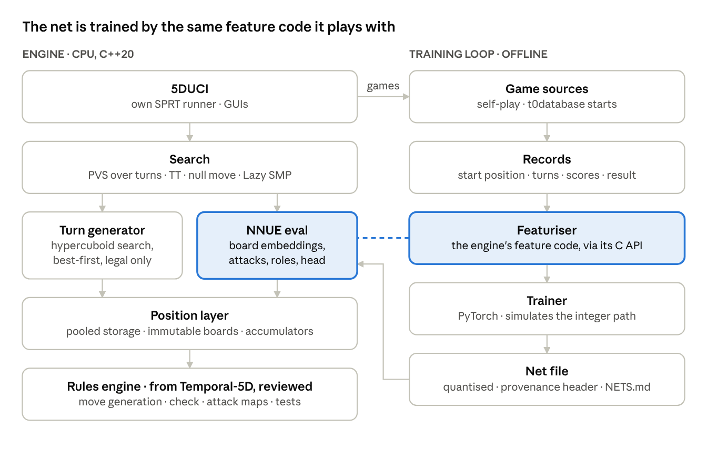
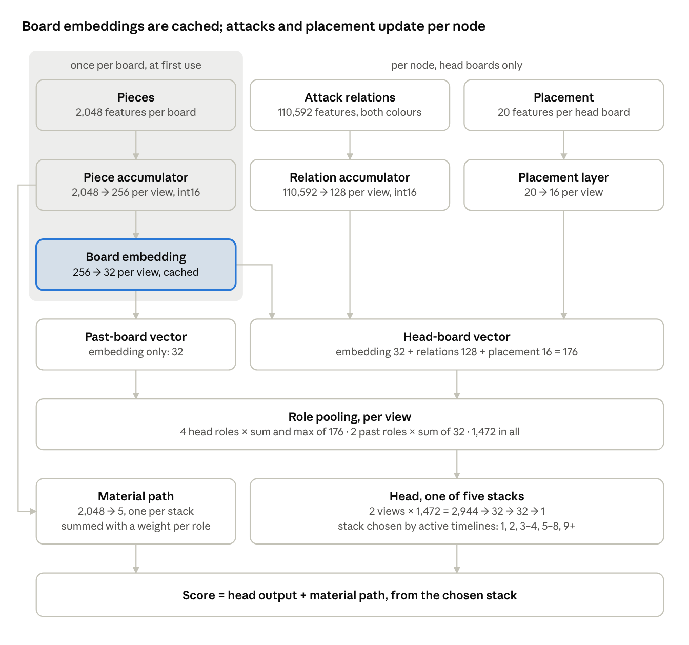
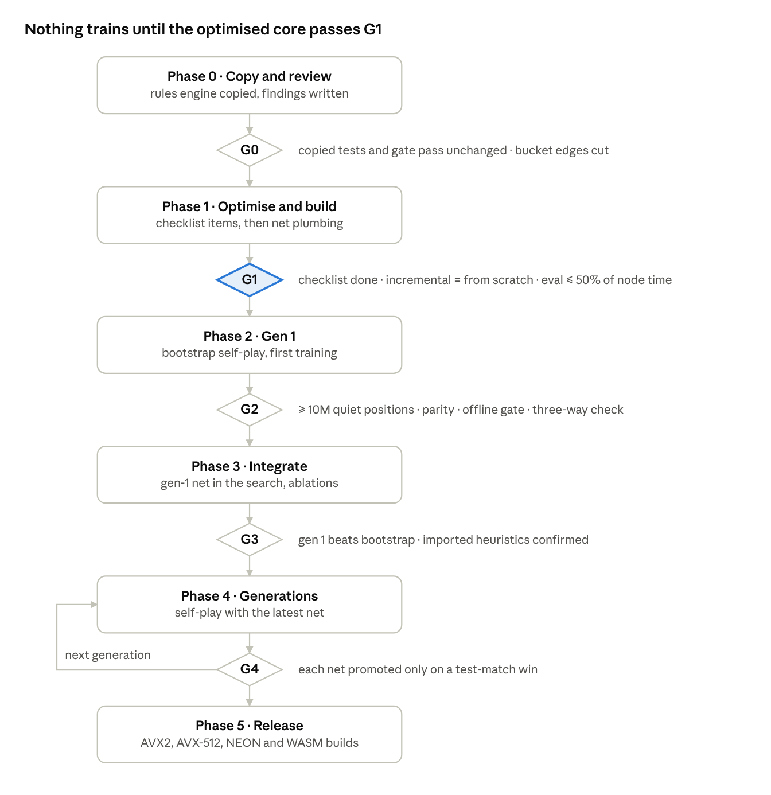

# 5D NNUE engine — design spec

1 November 2026 · Fergus

## 0. Status and scope

Draft of 7 November 2026. Nothing is built yet; Phase 0, copy and review, is next. Every bracketed ID has a row in the [decision register](DECISIONS.md).

**What it is.** A new engine for 5D Chess With Multiverse Time Travel: alpha-beta search over whole turns, evaluated by an NNUE that reads the boards themselves. CPU only, C++20, its own repo [NS1].

**What it isn't.**

- Not part of Temporal-5D, and not a second Temporal-5D engine.
- Not a Kairos fork or add-on, and not an HCE/NNUE combination: no hand-crafted eval as an input, overlay, blend or fallback [NF1].
- Not trained on any other engine's evaluations [P6, NF5].

**Relation to other projects.** Completely separate, with no build- or run-time dependency on either [NS2, NF10].

- **Temporal-5D.** Its rules engine is copied in, because that code would be identical in an NNUE engine. Before changing anything, the coder reviews it for NNUE-specific optimisations (§3) [NS3].
- **Kairos.** Ideas and test results only, no code [NS4, NF12]. Its newest eval is a board-level NNUE, so its test-match record (§13.2) is the best evidence available for this design.

**Goals.**

1. Play useful 5D chess within weeks, without waiting months for GPU training.
2. Run well on CPU-only machines and weak GPUs, and later in the browser.
3. Train on a desktop CPU; a GPU only speeds it up [NL4].

**Gen-1 variants:** Standard, Turn Zero, Defended Pawn and Half Reflected, confirmed at G0 [NS5]. The engine is called Chronos; its repo is github.com/Silicon-Spider/Chronos.

## 1. Engine at a glance

*engine and training loop · only the rules engine comes from Temporal-5D*

- **Position:** a persistent multiverse of immutable boards. Each board carries its piece accumulator and a cached 32-wide embedding, computed once, the first time an evaluation needs it [NB1, NN1, NN2].
- **Turns:** the turn generator yields legal turns best first, so the search never checks a move's legality itself [NT2, NF13].
- **Search:** PVS over whole turns. The net scores leaves from the cached embeddings plus attack relations and placement, which update per node [NA1, NN3–NN6].
- **Training loop:** self-play games feed a PyTorch trainer that reads features through the engine's own code, so training and play see identical inputs [ND2, NL1].
- **One evaluator throughout:** before any training, a hand-set bootstrap net in the same format plays gen 1 [P4, NN8].

## 2. Principles

All eight are committed.

- **P1 Facts, not opinions.** Inputs are what's on the boards and what the rules say: pieces, attacks and placement. Nothing is hand-weighted. Unweighted rule-fact counts are facts too, but only the fallback arm NX2 may use them.
- **P2 Rules live in the rules engine.** The search and the net ask it; neither re-derives a rule [NF6].
- **P3 Immutability.** A published board never changes, so its accumulator, embedding and attack scan are computed once and shared by every position that contains it.
- **P4 One evaluator.** The net is the only eval. Before training, a hand-set bootstrap net in the same file format stands in; it plays gen 1 and then retires [NN8, NF1, NF2].
- **P5 Measure, don't assume.** A heuristic imported from Kairos or chess stays only if an ablation test match in this engine confirms it. Kairos's wins are priors, not results.
- **P6 Self-taught.** Nets train only on this engine's own searches and game results. Human games supply start positions and a held-out check, never labels [NF5].
- **P7 Untrained first.** The whole engine, net plumbing included, passes G1 with the bootstrap net before anything trains.
- **P8 Borrowed code proves itself.** Copied code passes its own tests unchanged before any change, and again after each one [NM1].

## 3. Rules engine

The rules engine comes from Temporal-5D because it would be the same code whether the evaluator were an NNUE or a transformer. Nothing built for the transformer or its MCTS search comes across [NS3, NF11].

### 3.1 Copied

C++20 from one pinned commit; which one is open, and 2cb107d (2 November 2026) is current [NR1]. Lines count header plus source: 15,560 in these modules, plus 224 in two internal headers they include.

| Module | Lines | What it does |
| --- | --- | --- |
| types, geometry, error | 487 | Core types, board geometry, error reporting |
| board | 261 | Immutable board: mailbox, bitboards per colour, per kind and for unmoved pieces, content hash |
| timeline, multiverse | 852 | Persistent multiverse, copy-on-write per timeline, boards in shared chunks of 16 |
| zobrist | 320 | 5D position hash |
| rules, variants, state | 1,811 | Rulesets, variants, the present and the turn state machine |
| move, movegen, attacks | 1,795 | Pseudo-legal moves from compile-time tables, for either colour on any board, with defences, x-rays and pins from the same pass |
| check | 621 | Check detection and the incremental royal-attack maps |
| search, legal | 1,740 | Legal-action listing and mate detection. legal holds the per-move legality tiers and comes only because search includes it; the engine's search never calls it [NF13] |
| hypercuboid, turngen | 2,423 | Best-first legal-turn generator (§5) |
| fen, pgn | 2,722 | 5DFEN and 5DPGN readers and writers |
| fingerprint, certificate, md5 | 510 | Position fingerprints and checkmate certificates; md5 was written from the RFC |
| gate | 630 | Adapter for the differential test harness |
| capi | 1,388 | C API for games and states, with its expansion and label calls removed |

Also copied: the 64 test files, including the brute-force reference on tiny multiverses; the differential harness, whose oracles (ftxi, cwmtt, Chess in 5D and Kairos) run as outside programs; the rulebook with rulings R1–R11 [NR4]; and data/t0database with its MIT licence.

### 3.2 Not copied

Transformer and MCTS code, and the verification layer built around Temporal-5D's search [NR2, NF11]:

- **expand, labels, views:** the transformer's input expansion, per-square labels and views.
- **mcts, mcts_evaluators, selfplay, capi_search:** the MCTS search, its self-play and its C API.
- **scanner, guard, hunt, prover, ladder, assets:** alpha-beta finds its own tactics. Guard proved useful at no board count, and Hunt's hit rate on short forced mates fell from 69% under 50 boards to 35% at 100–199.

### 3.3 Review checklist

Before changing copied code, the coder reviews it against this list and writes one finding per item: expected gain, risk and the tests affected. Changes then land one item at a time, each followed by the full copied test suite, the gate and a speed measurement [NR3, P8, NM6].

1. **Board storage.** Replace `BoardRef = std::shared_ptr<const Board>` with per-thread pools, so making and unmaking moves needs no atomic reference counts [NB2].
2. **Accumulator beside each board, built lazily.** `BoardBuilder` records which squares changed. The accumulator is built the first time an evaluation needs it, from the nearest ancestor that has one, because many boards the turn generator builds are never evaluated; Stockfish defers its updates the same way [NN9].
3. **Cached embedding.** Compute each board's 256→32 embedding and material sums with its accumulator and keep them, so pooling reads 32 cached numbers per board instead of running the 256-wide accumulator through a layer at every eval [NN2, NN13].
4. **Attack indices from movegen.** Movegen already emits `GeometricRelation` records, defences included, in the same pass as moves; have it emit the net's relation indices too [NI3, NI4].
5. **Attack maps for every attack.** Extend the royal-attack maps to all attacks on enemy and own pieces, keeping their update rule: drop sources that are no longer playable, scan new boards, and re-extend only the lines that stopped where a board now exists [NN3].
6. **Turn generator.** Integer scores, per-thread pooled working memory, no heap allocation per node [NT2].
7. **Move lists.** Fixed-size per-thread buffers.

### 3.4 Copy process

1. Pin one Temporal-5D commit. Copy the files above into the new repo, each with a provenance header giving its source path and commit [NR5].
2. Remove capi's expansion and label entry points and the record types only they use. Change nothing else yet.
3. Build, then run the copied tests and the gate unchanged. Passing is the core of G0 [NM1].
4. Apply the review checklist one item at a time (§3.3).
5. Merge later Temporal-5D fixes by hand, recording each source commit; never through a dependency [NR5, NS2].

Licensing is clean: Temporal-5D is yours outright under GPL-3.0, and its md5 was written from the RFC [NE5].

## 4. Position and boards

- **Board** [NB1]: Temporal-5D's immutable board (mailbox, bitboards per colour, per kind and for unmoved pieces, content hash, en passant square, width and height). Its NNUE state sits beside it, built the first time an evaluation needs it [NN9]:
    - piece accumulator: 2 views × 256 int16, 1 KB;
    - material sums: 2 views × 5, one per output stack [NN13];
    - cached embedding: 2 views × 32;
    - its attack scan, which the attack maps reuse.
- **Storage** [NB2]: per-thread pools instead of reference counting. Provisional until G1 measures the gain over `shared_ptr`.
- **Multiverse** [NB3]: persistent and copy-on-write per timeline, with boards in shared chunks of 16. Copying a position costs one pointer per timeline.
- **Hash** [NB4]: a board's content hash ignores where the board stands. The position key mixes each content hash with the board's timeline and half-turn by multiply-rotate rounds, then adds the terms with 64-bit addition, so identical boards never cancel and a new board costs one addition. Ruleset, side to move, even or odd start and board size are folded into the final key.
- **Content cache** [NN10]: a per-thread table keyed by content hash shares accumulators, material sums and embeddings between boards with identical contents, which recur across sibling nodes, transpositions and timelines.

## 5. Turn generation

### 5.1 Search unit

The search unit is a complete turn: every sub-move the side plays before submitting [NT1]. Provisional: arm NX9 tests one sub-move per ply instead.

### 5.2 Generator

Temporal-5D's hypercuboid generator, copied [NT2]:

- It treats a turn as one choice per playable board: pass, a physical move, a departure, an arrival or a branch.
- It searches that space in boxes, best first, from a priority queue keyed by each box's score bound, so turns arrive in descending order of summed sub-move score.
- It yields only legal turns, each once. The search therefore never runs exact per-move legality, whose worst case is 145 s at 400 boards and 200 s at 600 [NF13].

| Temporal-5D measurement | Result |
| --- | --- |
| Hypercuboid against naive enumeration, 5 timelines, near mate | 184 nodes in under 1 ms, against 817,875 nodes |
| Turns generated per search node | About 27 |
| Generators stopped by their budget | 0–8 of 400 |
| Pseudo-legal movegen, one thread, Ryzen 9 9900X | 171,804 positions/s at 100 boards to 58,002/s at 600 |
| Pseudo-legal expansion, corpus median | 2 µs under 50 boards to 67 µs at 240–399; fast legality costs 3–5× that |

**Most turns are narrow.** In 692 human games, the side to move had one mandatory board in 94% of turns under 50 boards, 73% at 50–99 and 36% at 100–199. Wide turns arrive as the multiverse grows, which is where best-first order pays.

### 5.3 Order and scores

- **Turn order** [NT3]: the TT hint first, then turns by summed sub-move score. Quiet turns are ordered by their individual moves rather than a summed score, which won a Kairos test match.
- **Sub-move scores** [NT4]: captures by victim and attacker, then history with gravity (scores decay as they grow) and maluses (moves tried before the cutoff lose score), which also won in Kairos.
- Both stay provisional until their G3 ablations [P5].

### 5.4 Budget rule

A generator stopped by its budget proves nothing [NT5]:

- If it has yielded turns, the search uses those.
- If it has yielded none, the node takes its static eval, flagged as unproven, and the TT never stores it as mate or as exact.
- The engine never scores a false mate.

## 6. Search

| Part | v1 choice | Status |
| --- | --- | --- |
| Driver [NA1] | Iterative deepening, aspiration windows, PVS over whole turns | Committed |
| TT [NA2] | Keyed by the 5D hash: score, bound, depth, and the best turn's first three sub-moves as a hint | Provisional |
| Pruning [NA3] | Late-move pruning with no cap, LMR, board-rank pruning | Provisional |
| Null move [NA4] | The side passes its whole turn; where passing gets mated, that node gets no reductions or board-rank skips | Provisional |
| Quiescence [NA5] | Two turns deep, captures with SEE ≥ 0 | Provisional, arm NX1 |
| Verdicts [NA6] | Mate, stalemate and game end come from the rules engine; no repetition rule (ruling R5) | Committed |
| Time [NA7] | A budget per move from clock and increment | Provisional |
| Threads [NA8] | Lazy SMP over one shared TT | Committed |

**Board-rank pruning**, from Kairos: each sub-move has a rank in its board's move order, and late quiet multi-board turns whose ranks sum to more than 6 per board are skipped.

**Taken from Kairos, each a test-match winner there:** board-rank pruning, no reductions where passing gets mated, uncapped late-move pruning, history with gravity and maluses, and quiet turns ordered by their moves. Each is re-tested by ablation here at G3 [P5]. Kairos's capture-search changes (deeper, capped, using the TT) all came out neutral, which supports a shallow quiescence.

Arms for later: correction history [NX7] runs first, then futility pruning [NX6], singular extensions [NX18] and a proof-number mate solver on a helper thread [NX21].

## 7. Evaluation inputs

Every input is provisional until G2 shows the net learns from it; the exclusions are committed.

### 7.1 Boards

[NI1]

- **Head boards**, the latest board of each timeline, in four roles:
    - **mandatory:** the side to move must play it this turn;
    - **optional:** playable this turn but not owed;
    - **opponent:** the opponent moves next there;
    - **inactive:** its timeline is inactive.
- **Past boards**, near (1–2 half-turns behind their head) and far (3–4 behind), read through their cached embeddings only. Adding them won 9.7 ± 7.0 Elo in Kairos, and they cost almost nothing because the embeddings already exist.
- Older boards enter only as victims of attacks, through time travel.

### 7.2 Pieces

2,048 features per board and view [NI2]:

- 12 kinds × 2 colours × 64 squares = 1,536. The kinds: pawn, knight, bishop, rook, queen, king, unicorn, dragon, princess, brawn, common king and royal queen.
- Unmoved flags for the four kinds whose moves depend on them (king, rook, pawn and brawn) × 2 colours × 64 squares = 512.
- Black's view mirrors ranks. Smaller boards use the same 64-square index, rank × 8 + file.

### 7.3 Attack relations

A relation is one attack: a piece on a head board that could capture an enemy piece under 5D movement, as the rules engine's movegen computes it [NI3].

- Both colours, from every head board, whoever moves there next. Each relation belongs to the attacker's board.
- Victims of both colours: attacks on enemy pieces and on own pieces (defence), as Stockfish's threat inputs count both. Without defence the net can't tell a hanging piece from a protected one; arm NX4 tests dropping it.
- Travel captures into past boards and captures across timelines are included.

**Index** [NI4]: attacker kind × attacker colour × victim kind × victim colour × victim location × displacement class.

- **Victim location:** all 64 squares on the same board; 16 zones of 2×2 squares across boards. Arm NX12 tests full squares across boards, and NX13 adds the attacker's square.
- **Displacement class** [NI5], from the attacker's board to the victim's, nine in all: same board; timeline only, |ΔL| = 1, 2, 3+; time only, |ΔT| = 1, 2, 3+ half-turns; both, max(|ΔL|, |ΔT|) = 1, 2+. G0 re-cuts the edges from a histogram of attack distances in t0database. Unsigned; arm NX17 tests signed ΔL.
- **Size:** same board 12 × 2 × 12 × 2 × 64 = 36,864; across boards 12 × 2 × 12 × 2 × 16 × 8 = 73,728; 110,592 in all. G0 trims it as Stockfish trims its threat inputs: symmetric same-kind pairs counted once and impossible combinations dropped.

**Why relations.** They're what links boards; §7.6 shows what Kairos's net lost without them. A linear kernel over L/T offsets would update incrementally but can't tell whether a slider's path across boards is clear [NF3], and raw offsets are unbounded [NF4]. Reach, moves onto empty squares, is arm NX3; in Kairos it lost 11 ± 7. Per-square attacker counts, from dlshogi's inputs, are arm NX20.

### 7.4 Placement

Twenty features per head board, recomputed per node because the present moves [NI6]:

| Feature | Values |
| --- | --- |
| Who moves there next | mine, theirs (2) |
| Playable for the side to move | no, mandatory, optional (3) |
| Timeline owner | main line, mine, theirs (3) |
| Distance from the main line | 0, 1, 2, 3+ (4) |
| Timeline state | active, inactive (2) |
| Δt to the present | six buckets, cut at G0 (6) |

No ruleset flag: piece kinds and placement identify the variant, and each variant gets its own test match [NI7].

### 7.5 Excluded

Committed exclusions [NI8, P1]:

- material values or counts, mobility counts, king-safety scores, timeline-advantage and pawn-structure terms;
- the output of any hand-crafted eval;
- search-derived values such as history or correction terms;
- global counts such as active timelines per side, because summed placement already carries them.

The one exception is the fallback arm NX2: unweighted counts the rules engine produces, tried only if relations fail NQ2.

### 7.6 Why Kairos's board-only net failed

Kairos's pure-net test (nodense100, 24 October) lost 255.5 ± 18.2 Elo, 399 wins to 1,737 losses, against its counts-fed net at a 75% blend. The pure net put each timeline's latest board through a 128-wide accumulator and a 32-wide embedding, then summed the embeddings by role and added role counts. Nothing in it linked one board to another.

- **The missing information crosses boards.** The 172 counts it dropped are mostly facts linking boards: time-travel landings next to a royal and whether they're defended, squares near a royal attacked across time or timelines, open lines through timelines, hanging pieces, mobility and timeline slots. A sum of per-board vectors can't express a queen on L0 that can travel to L−1 and mate, because that depends on both boards at once. It isn't capacity: 256-wide accumulators lost slightly (−3.9 ± 7.1).
- **That's where games are decided.** 99.65% of Kairos's 1.67M test games since 20 October ended in checkmate.
- **Its labels had causes it couldn't see.** It trained on search scores driven by those counts, so it learned material and placement and averaged out the rest.
- **Sums dilute the worst board.** Several of the counts are worst-board maxima. Kairos's max-pooling test (+4.0 ± 6.7) ran with them present, so it says nothing about a net without them.
- **Its cross-board channel never played.** Kairos built 7,200 relation features from time-travel and cross-timeline moves, recomputed by move generation at every eval for 3.0 µs, about the cost of the hand-crafted pass they would have replaced. They were cut before any test match.

This design answers each point: relations for both colours and both victim colours, on the same board and across boards (§7.3); incremental attack maps for their cost (§3.3, NM6); sum and max pooling (§8); and a board-only control that repeats Kairos's failure in this engine [NM10], checked offline at G2 before any match [NM12]. The remaining risk: the net must learn aggregates such as "defended only by the king" that the counts handed Kairos ready-made. If relations close too little of the gap by G3, NX2 is next.

## 8. Network

*v1 network · cached board state, per-node relations and placement, sum-and-max pooling, head plus material path*

About 15.2M parameters, 93% of them in the relation table; the net file is about 30 MB before G0's trimming.

| Stage | Shape, per view | Computed |
| --- | --- | --- |
| Piece accumulator [NN1] | 2,048 → 256, int16 | Once per board, at first use |
| Material path [NN13] | 2,048 → 5, one per output stack | Once per board, with the accumulator |
| Board embedding [NN2] | 256 → 32 after clipped ReLU | Once per board, cached with it |
| Relation accumulator [NN3] | 110,592 → 128, int16 | Per node, from the attack maps, on each head board |
| Placement layer [NN4] | 20 → 16 | Per node, on each head board |
| Head-board vector | 32 + 128 + 16 = 176 | Per node |
| Role pooling [NN5] | 4 head roles × (sum, max) × 176 + 2 past roles × 32 = 1,472 | Per eval |
| Head [NN6, NN7] | 2 views × 1,472 = 2,944 → 32 → 32 → 1 | Per eval, one of five stacks |
| Score | The head's output plus the stack's material path | Per eval |

- **Roles** [NN5]: mandatory, optional, opponent and inactive head boards, each pooled by sum and max; past boards near and far, by sum. The max lets one board's mating attack count in full instead of being diluted across quiet boards (§7.6). KataGo's nets pool with both mean and max. Arm NX19 tests sum alone, or mean plus count.
- **Material path** [NN13]: the piece table carries five more columns, one per output stack, as Stockfish's feature transformer feeds piece-square totals straight to the score. Each head board's value is summed with one learned weight per role. Material is learnable from the first batch, and the rest of the net only learns what material misses.
- **Output stacks** [NN7]: chosen by active-timeline count: 1, 2, 3–4, 5–8, 9+.
- **Views:** each board is accumulated from both colours' perspectives, black's mirrored, and the head reads the side to move's view first.

### 8.1 Bootstrap net

The bootstrap net is the material path alone: hand-set material values in its columns, equal role weights, and every other weight zero [NN8, P4]. Values for 5D's extra pieces are an open item. It retires once gen 1 beats it [NQ1].

### 8.2 Incremental contract

[NN9]

- A board's piece accumulator and material sums are built the first time an evaluation needs them, from the nearest ancestor that has them, plus the columns for pieces added and minus those removed; `BoardBuilder` records the changed squares. Many boards the turn generator builds are never evaluated, and Stockfish defers its updates the same way. The embedding is computed once from the result.
- Relation accumulators update from the attack maps: relations from dropped sources come off, and relations from newly scanned boards and re-extended lines go on.
- Placement is recomputed per node for head boards; it's 20 features.
- Every incremental result equals a from-scratch rebuild, checked at every node in tests [NM2].

### 8.3 Caches

[NN10]

- **Content cache, across nodes:** keyed by board content hash; holds accumulators, material sums and embeddings, per thread.
- **Successor cache, within a node:** each sub-move's successor board is built once per node and shared by every turn that contains it, rather than rebuilt for each of the node's turns.

### 8.4 Integer pipeline

[NN11]

- int16 accumulators; int8 weights in the dense layers; int32 sums, shifted and clipped to int8 between layers.
- Scales live in the net file header [NL5], and training simulates the rounding [NL7]. Output is bit-identical across AVX2, AVX-512, NEON, WASM and the Python reference [NM3, NM4].

### 8.5 Cost

Eval stays at or under half of node time [NN12, NQ4]. Per node, that's a few column updates per new board, relation updates only where the attack maps changed, 176 or 32 numbers pooled per board, and a 2,944 × 32 head. The attack channel is the risk: Kairos dropped its own after it cost about 3 µs per eval, mostly in move generation. Defence relations double the table, so G1 measures the channel's cost first, with and without them [NM6, NX4].

## 9. Training data

| Decision | Choice | Status |
| --- | --- | --- |
| Records [ND1] | Positions, never features: game, turn, 5DFEN or start plus moves, search score, depth, best turn, result | Committed |
| Gen 1 [ND2] | Self-play with the bootstrap net, at least 10M quiet positions | Provisional, G2 |
| Gen 2 on [ND3] | Self-play with the latest promoted net, training on a three-generation window | Provisional, G4 |
| Starts [ND4] | The engine's own opening generator plus positions from t0database | Provisional, G0 |
| Labels [ND5] | λ × score + (1 − λ) × result; λ 0.2 in gen 1, rising toward 0.7 | Provisional, G2 |
| Filter [ND6] | Quiet positions only | Provisional, arm NX5 |
| Provenance [ND7] | Engine commit, net hash, variant, start source and search settings on every record | Committed |
| Validation [ND8] | Split by game; held-out t0database games scored against their human results | Committed |
| Rescoring [ND9] | Stored positions re-searched with each newly promoted net, refreshing the window's labels | Provisional, G4 |
| Depth caps [ND10] | Most self-play moves searched shallow and not recorded; a fraction searched at full depth and recorded | Provisional, G2 |
| Oversampling [ND11] | Positions where deep search disagrees most with the static eval are sampled more often | Provisional, G2 |

- **Why quiet only.** Kairos's net trained on all positions lost 43 ± 11 Elo to its quiet-trained net: labels on tactical positions carried tactics the search couldn't confirm. Quiet here means not in check, best turn not a capture, and quiescence within a small margin of the static eval.
- **Why λ starts low.** The bootstrap net knows only material, so gen 1's scores are weak, and results carry most of the label until the nets improve. Kairos's 70/30 score/result split beat 90/10 by 27 ± 17, which sets the target.
- **Why t0database starts.** Random openings with a few noisy moves rarely reach many timelines, and that's the regime this net exists for. t0database holds 761 human games from 2021–2025 (692 usable, about 29,000 turns) under the MIT licence: enough for starts and a held-out check, too small for labels [P6].
- **Held out.** A fixed third of t0database games, split by game, never supplies starts; each net is scored on it against the human results.
- **Why depth caps.** More games per CPU hour mean more result labels and more varied positions, and only the deep searches become training targets. KataGo does the same with its playouts.
- **Why oversampling.** Positions the net misjudges carry the most signal. KataGo weights its training the same way, by how much search surprised the net.
- **Why rescoring.** Records hold positions (ND1), so a new net's search can relabel the whole window for less than replaying it. Stockfish 19 rescored all its data the same way, but with another engine's net, which is refused here [NF5].
- **Gen-1 node budget** and the depth-cap split are set once the datagen rate is measured (open items).

## 10. Training pipeline

- **Featuriser** [NL1]: the engine's own feature code, exported through its C API and called from Python with ctypes, so training reads exactly the indices the engine computes [NM3].
- **Trainer** [NL2]: PyTorch, with sparse embedding bags for piece and relation features and a sum and max per role per position. An integer reference in Python reproduces the engine's quantised output exactly [NM3].
- **Factorised features** [NL3]: during training, shared virtual features (piece kind and colour across squares; attacker and victim kind across locations and classes) help the sparse relation table learn from limited data. They fold into the real weights at export. Provisional, G2.
- **Quantisation-aware training** [NL7]: training simulates the engine's integer rounding, as Stockfish 19 does, so the exported net loses less to quantisation. Provisional, G2.
- **Auxiliary targets** [NL8]: training-only heads predict facts from the game's future: who gets mated and on which board, material per board a few turns on, and the score at greater search depths. They add signal per position and are dropped at export, so they cost nothing in play. Auxiliary targets are a large part of KataGo's data efficiency. Provisional, G2: kept only if they lower held-out loss on the main target.
- **CPU first** [NL4]: gen 1 must train on a desktop CPU; a GPU only speeds it up.
- **Net file** [NL5]: a header with magic, format version, architecture and feature-set hashes, quantisation scales, data provenance and a checksum.
- **Net log** [NL6]: NETS.md records each net's data, training settings, offline-gate result and test-match result. A net is promoted only on a test-match win, and the last good net stays the default.

## 11. Protocol and platforms

- **Protocol** [NE1]: 5DUCI, UCI's command set over standard input and output. Positions arrive as 5DFEN or as a start plus 5DPGN moves; `bestmove` returns a whole turn in 5DPGN; `info` lines carry depth, score, nodes, nps and the principal variation.
- **Options** [NE2]: Threads, Hash, EvalFile, Move Overhead, and a deterministic mode for tests.
- **Targets** [NE3]: x86-64 with AVX2 and AVX-512, ARM with NEON, and WASM SIMD through Emscripten in Phase 5. The net budget for the browser build is an open item.
- **Determinism** [NE4]: a single-thread fixed-node search gives the same result on every run, compiler and SIMD target.
- **Licence** [NE5]: GPL-3.0, sole copyright yours. t0database keeps its MIT licence file.
- **Toolchain** [NE6]: C++20; g++ 13 or later, or clang; CMake and Ninja; on Windows, MSYS2 ucrt64, where g++ 16.2 is already set up.

## 12. Testing and predictions

### 12.1 Measurements

| ID | Check | Gate |
| --- | --- | --- |
| NM1 | Copied tests and gate pass unchanged, then after every change | G0, G1 |
| NM2 | Incremental accumulators, embeddings and relations equal a from-scratch rebuild at every node | G1 |
| NM3 | Featuriser and integer reference match the engine exactly | G2 |
| NM4 | The same eval checksum on every SIMD target; a colour-swapped position gives the negated eval | G1 |
| NM5 | Own tactics and mate sets from t0database and self-play, with mates certified by the rules engine | G3 |
| NM6 | Node time split by stage (movegen, turn generation, relations, pooling, head), attack-channel cost first | G1 |
| NM7 | Own test-match runner: paired openings, pentanomial GSPRT | G3 |
| NM8 | Results bucketed by active-timeline count, with openings from t0database | G3 |
| NM9 | Offline gate: a new net beats the current one on held-out loss and passes parity before any match | G2 |
| NM10 | Board-only control: the same net without relation inputs, trained on the same data | G3 |
| NM11 | Kairos at a pinned commit as an optional outside yardstick, run as a separate program | — |
| NM12 | Three-way check: board-only, plus attack relations, plus defence relations, trained on the same data and compared on held-out loss before any match | G2 |

### 12.2 Predictions

Each is written down before its test runs.

- **NQ1:** gen 1 beats the bootstrap net by more than 100 Elo.
- **NQ2:** the full net beats the board-only control by more than 100 Elo. If it doesn't, arm NX2 is next.
- **NQ3:** that margin grows with active timelines.
- **NQ4:** eval takes under 50% of node time.
- **NQ5:** quiescence at two turns beats zero and four.
- **NQ6:** the engine beats the pinned Kairos commit at 10+0.1 by gen 8.

## 13. Sources

### 13.1 Temporal-5D

The code copied under §3. Designs and measurements cited from its engine manual and measurement log: movegen rates, turn width, the hypercuboid comparison, the budget rule and the legality worst case. Read from a clone at 2cb107d.

### 13.2 Kairos's test record

Kairos's newest eval is a board-level NNUE: 128-wide per-board accumulators, 32-wide board summaries, six board roles and 172 hand-crafted counts, with its attack channel turned off in the shipped net. Read on 7 November 2026, with main at b2c36c9 and results from its test-match branch:

| Test | Elo | Used here |
| --- | --- | --- |
| First NNUE, 50% blend, against its hand-crafted eval | +89.0 ± 22.6 | NNUE with alpha-beta pays in 5D |
| The same net alone | +32.5 ± 25.7 | A net alone beats hand-crafted terms |
| Pure net (no hand-crafted counts, no relations, no blend) against its counts-fed net at a 75% blend | −255.5 ± 18.2, 399 wins to 1,737 losses | Why it failed: §7.6; board-only control [NM10], three-way check [NM12], fallback NX2 |
| 256-wide board accumulators instead of 128 | −3.9 ± 7.1 and −7.2 ± 6.9 | Capacity isn't the gap |
| Relation channel: 7,200 cross-board move features | Never tested; cut at 3.0 µs per eval | Incremental attack maps [NN3]; cost measured first [NM6] |
| How its 1.67M test games since 20 October ended | 99.65% checkmate | Royal danger decides 5D games; mate-solver arm NX21 |
| Trained on all positions instead of quiet ones | −43.0 ± 10.9 | Quiet positions only [ND6]; NX5 retests |
| Labels 70/30 score/result against 90/10 | +27.0 ± 16.9 | λ target 0.7 [ND5] |
| Past boards as inputs | +9.7 ± 7.0 | Past boards near and far [NI1] |
| Retrains on its own games | +8, +21, +35.4 ± 10.7, then −17.1 ± 8.1 | Promote only on a win [NL6] |
| Net at 100% instead of a 75% blend | −30.3 ± 9.7 | Its hand-crafted eval still adds something; no blending here [NF1] |
| Max instead of sum pooling | +4.0 ± 6.7, inconclusive | Ran with its worst-board counts present; max pooling in v1 [NN5], NX19 tests without it |
| Reach terms in its correction net | −10.9 ± 7.4 | Reach is an arm [NX3] |
| Deeper and capped capture search | −5.1 and +0.2, neutral | Shallow quiescence [NA5]; NX1 |

Accepted search ideas, each a match winner: board-rank pruning at a rank sum of 6 per board, no reductions where passing gets mated, uncapped late-move pruning, history with gravity and maluses, and quiet turns ordered by their moves.

### 13.3 Ideas from other engines

Ideas only, no code [NF12]. Each enters as a provisional decision or an arm.

| Engine | Idea | Used here |
| --- | --- | --- |
| Stockfish 18–19 | Threat inputs: attacker–victim pairs, both colours, own and enemy victims, duplicates counted once, updated from the attacks that changed; about +14 Elo in one long-time-control test. Stockfish 19 removed redundant ones | Defence relations in v1 and G0 trimming [NI3, NI4] |
| Stockfish | The feature transformer feeds piece-square totals straight to the score | Material path [NN13] |
| Stockfish | Lazy accumulator updates | Board state built at first use [NN9] |
| Stockfish 19 | Quantisation-aware training | [NL7] |
| Stockfish 19 | All training positions rescored with one strong evaluator, Leela's | Rescoring with this engine's own nets [ND9]; never another engine's [NF5] |
| Stockfish 19 | Its second, smaller net retired | Backs NF2 |
| Stockfish, KataGo | Correction history; KataGo's subtree value bias correction, the same idea, was worth 30–60 Elo | NX7 runs first |
| Lc0 | A learned attention bias (plays as if 50% larger, negligible throughput cost) and smolgen, a bias generated from the position (another 50%, for 10% throughput) | The design for NX10 |
| KataGo | Training-only auxiliary targets such as ownership and future values; its methods together cut compute about 50× | Auxiliary targets [NL8] |
| KataGo | Cheap searches for most self-play moves, full ones for a few | Depth caps [ND10] |
| KataGo | Training weighted toward positions where search surprised the net | Oversampling [ND11] |
| KataGo | One net across board sizes, with size-independent pooling | Backs one net across timeline counts [NN5, NN7] |
| dlshogi | Inputs include squares attacked per piece type and attacker counts per square | Arm NX20 |
| YaneuraOu | NNUE began here, with king-relative inputs (HalfKP: 81 king squares × 1,548 piece-squares), on a shogi port of Stockfish's search | Backs NX14, and Stockfish-style search in a game with many moves per position |
| Shogi engines | Proof-number mate solvers (df-pn) beside the main search | Arm NX21 |

Not taken: training on other engines' evaluations, MCTS or policy-led search, and GPU transformers [NF5, NF8, NF9].

### 13.4 Data and oracles

- t0database (MageOfficial), MIT licence: 761 human games from 2021–2025, 692 usable.
- Differential oracles in the copied harness: ftxi, cwmtt, Chess in 5D and Kairos, each run as an outside program.

Sources:

- [Temporal-5D engine manual](https://github.com/Silicon-Spider/temporal-5d/blob/main/engine/README.md)
- [Temporal-5D measurements](https://github.com/Silicon-Spider/temporal-5d/blob/main/docs/MEASUREMENTS.md)
- [Temporal-5D rulebook](https://github.com/Silicon-Spider/temporal-5d/blob/main/docs/rules/README.md)
- [Kairos commit history](https://github.com/FirePlank/5d-chess-engine/commits/main/)
- [Kairos test-match branch](https://github.com/FirePlank/5d-chess-engine/commits/sprt/)
- [MageOfficial/t0database](https://github.com/MageOfficial/t0database)
- [Stockfish 19](https://stockfishchess.org/blog/2026/stockfish-19/)
- [Stockfish 18](https://stockfishchess.org/blog/2026/stockfish-18/)
- [Stockfish TI is coming (TalkChess)](https://talkchess.com/viewtopic.php?p=985205)
- [Stockfish full_threats.cpp (mirror)](https://huggingface.co/spaces/Amogh1221/deepcastle-api/blob/main/src/nnue/features/full_threats.cpp)
- [NNUE, Chessprogramming wiki](https://www.chessprogramming.org/NNUE)
- [Lc0: Transformer Progress](https://draft.lczero.org/blog/2024/02/transformer-progress)
- [KataGo methods](https://github.com/lightvector/KataGo/blob/master/docs/KataGoMethods.md)
- [KataGo paper](https://arxiv.org/abs/1902.10565)
- [dlshogi input features](https://github.com/TadaoYamaoka/DeepLearningShogi/blob/master/cppshogi/cppshogi.cpp)
- [YaneuraOu, Chessprogramming wiki](https://www.chessprogramming.org/YaneuraOu)
- [HalfKP dimensions (rshogi-core)](https://docs.rs/crate/rshogi-core/0.2.4/source/src/nnue/network_halfkp.rs)
- [Mate Search, Chessprogramming wiki](https://www.chessprogramming.org/Mate_Search)

## 14. Phases and gates

*phases 0–5 · gates G0–G4*

| Phase | Work | Gate: passes when |
| --- | --- | --- |
| 0 · Copy and review | Copy the rules engine at a pinned commit; import t0database; cut bucket edges; count live relation features; write review findings | G0: copied tests and gate pass unchanged in the new repo; displacement and Δt edges cut from t0database; relation table trimmed; gen-1 variants confirmed; baseline speeds recorded |
| 1 · Optimise and build | Review checklist, one item at a time; net plumbing, lazy board state, caches and SIMD with the bootstrap net; search v1 | G1: tests and gate pass after every item; incremental equals from-scratch [NM2]; SIMD checksums agree [NM4]; eval ≤ 50% of node time [NN12]; attack-channel cost recorded, with and without defence [NM6] |
| 2 · Gen 1 | Bootstrap self-play with depth caps; trainer, featuriser and integer reference | G2: at least 10M quiet positions; parity [NM3]; offline gate passed [NM9]; three-way check run [NM12] |
| 3 · Integrate | Gen-1 net in the search; ablations of the imported heuristics; the quiescence arm; time management; board-only control | G3: gen 1 beats the bootstrap net by test match [NQ1]; each imported heuristic confirmed or dropped; board-only control measured [NQ2] |
| 4 · Generations | Self-play with the latest net, three-generation window, rescoring | G4, each generation: promoted only on a test-match win [NL6] |
| 5 · Release | AVX2, AVX-512, NEON and WASM builds; packaged nets; NETS.md | Checksums agree on every target [NM4] |

### 14.1 Phase 0 brief

For the coding agent. Deliver a G0 report, and change no copied code until G0 passes.

1. Set up the repo, github.com/Silicon-Spider/Chronos, building with CMake and Ninja.
2. Pin a Temporal-5D commit. Copy the modules in §3.1 with the internal headers they include, the 64 test files, the oracle harness, the rulebook, and data/t0database with its licence. Give each file a provenance header.
3. Remove capi's expansion and label entry points and the record types only they use.
4. Build, then run the copied tests and the gate unchanged. Record any failure; don't fix it yet.
5. Record baseline speeds: pseudo-legal movegen, turn generation and the 5-timeline hypercuboid case.
6. Cut the displacement-class and Δt bucket edges from histograms over t0database, and count the relation features still live after Stockfish-style trimming [NI4, NI5, NI6].
7. Review the code against the checklist in §3.3 and write one finding per item: expected gain, risk and tests affected.
8. Split t0database by game into start and held-out sets [ND8].

## 15. Arms and refusals

### 15.1 Arms, in test order

Each arm is one change tested against v1 by test match after G3, bucketed by active timelines [P5, NM8]. They run in ID order, except correction history (NX7), which runs first.

| ID | Arm | Changes | Why |
| --- | --- | --- | --- |
| NX1 | Quiescence depth of 0, 2 or 4 turns | NA5 | Kairos's capture-search changes were neutral; tests NQ5 |
| NX2 | Unweighted rule-fact counts as extra inputs | NI8 | Fallback if relations fail NQ2; Kairos without its counts lost 255 |
| NX3 | Reach: moves onto empty squares across boards | NI3 | Branching chances are invisible without it; Kairos's reach terms lost 11 ± 7 |
| NX4 | Enemy victims only: drop defence relations | NI3 | Tests the v1 choice; halves the relation table |
| NX5 | All positions instead of quiet ones | ND6 | Kairos lost 43 ± 11; retest here |
| NX6 | Futility pruning | NA3 | Standard in chess engines |
| NX7 | Correction history; runs first | NA1 | Stockfish keeps it, and KataGo's equivalent was worth 30–60 Elo |
| NX8 | Move-prior head for turn order | NT3, NT4 | Ordering pays most in the turn generator |
| NX9 | One sub-move per ply instead of whole turns | NT1 | A finer search unit |
| NX10 | Attention over head boards: a learned bias by ΔL, ΔT and role, then a smolgen-style bias generated from the position | NN5 | Links between boards beyond direct attacks; in Lc0 each bias played as if the net were 50% larger |
| NX11 | Widths: relations 64 or 256, pieces 512, embedding 64 | NN1–NN3 | Size against speed |
| NX12 | Full victim squares across boards | NI4 | Finer than 2×2 zones |
| NX13 | The attacker's square in the relation index | NI4 | Stockfish's threat inputs index it |
| NX14 | King buckets for piece features | NI2 | Stockfish and YaneuraOu both index pieces by king square |
| NX15 | SCReLU instead of clipped ReLU | NN2, NN6 | Standard in chess NNUE |
| NX16 | WDL head | NN6 | Separates drawish positions from balanced ones |
| NX17 | Signed ΔL | NI5 | Whether the victim sits on your timelines or theirs |
| NX18 | Singular extensions | NA1 | Standard in chess engines |
| NX19 | Pooling: sum alone, or mean plus count instead of sum | NN5 | Tests the v1 sum-and-max pooling |
| NX20 | Per-square attacker counts per colour, capped at 3 | NI3 | dlshogi's inputs; a cheaper alternative if defence relations cost too much |
| NX21 | Proof-number mate solver (df-pn) on a helper thread at the root | NA8 | 99.65% of Kairos's games end in mate; shogi engines pair their search with such solvers |

### 15.2 Refusals

| ID | Refused | Why |
| --- | --- | --- |
| NF1 | Hand-crafted eval as an input, overlay, fallback or blend | P1, P4 |
| NF2 | Lazy-eval gates or a second net | P4; Stockfish 19 retired its small net |
| NF3 | An offset-indexed kernel over L/T | Linear, so it can't tell whether a slider's path is clear |
| NF4 | Raw-offset indexing | 5D offsets are unbounded |
| NF5 | Training on another engine's evaluations | P6 |
| NF6 | Rules logic outside the rules engine | P2 |
| NF7 | Storing features instead of positions | Features change with the net; positions don't [ND1] |
| NF8 | MCTS or a policy-driven main search | A cheap eval belongs with alpha-beta |
| NF9 | GPU inference | CPU only [NS1] |
| NF10 | Any build- or run-time dependency on Temporal-5D or Kairos | NS2 |
| NF11 | Copying Temporal-5D code built for the transformer or MCTS | NS3 |
| NF12 | Copying code from Kairos, Stockfish, Lc0, KataGo, dlshogi, YaneuraOu or the oracles | Ideas only |
| NF13 | Exact per-move legality in the search loop | Worst case 200 s at 600 boards; the turn generator yields legal turns |
